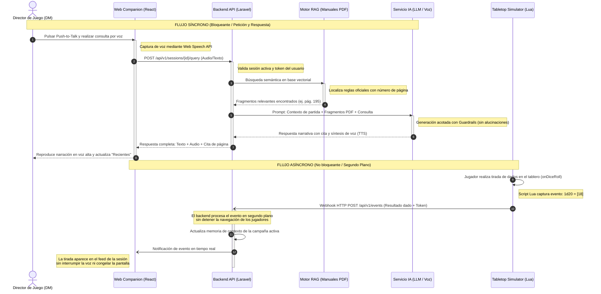
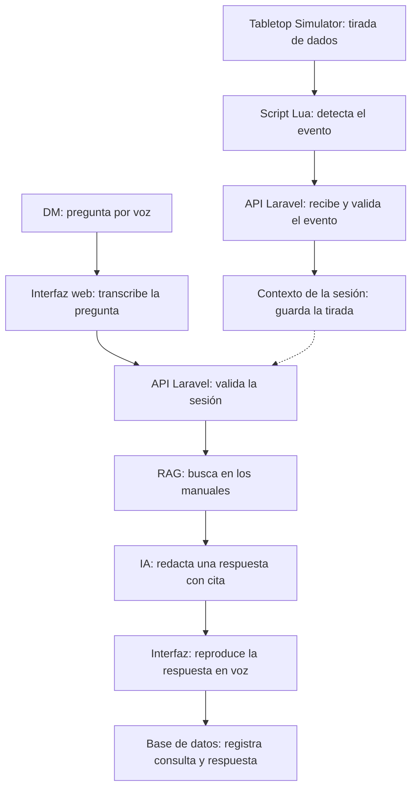
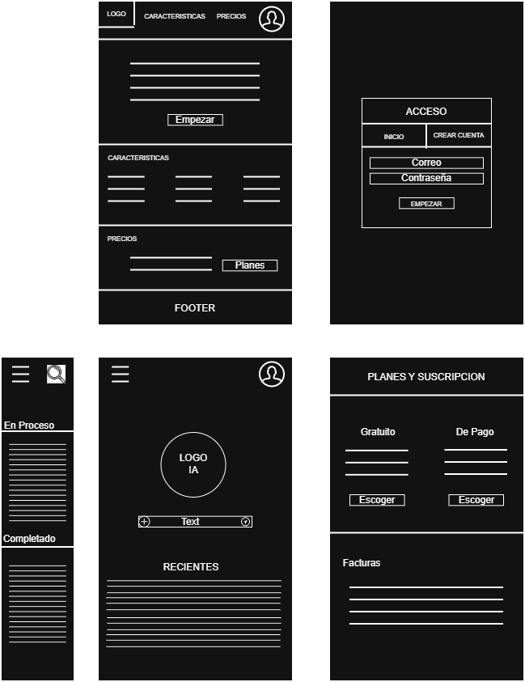
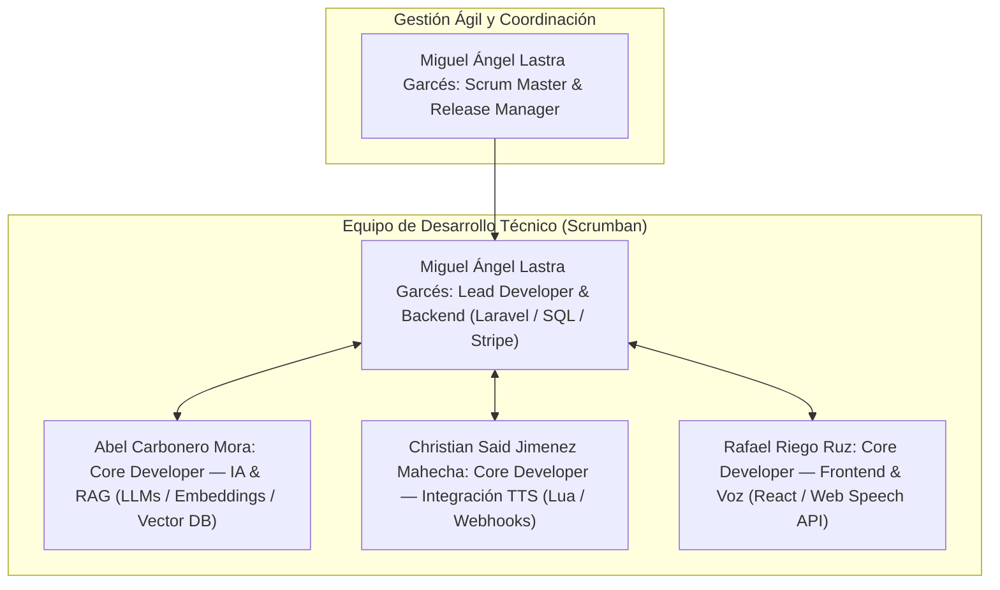
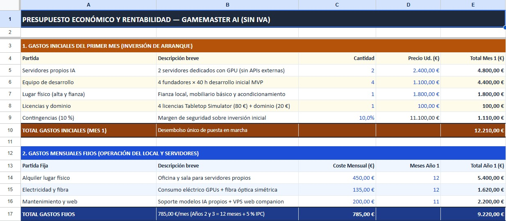
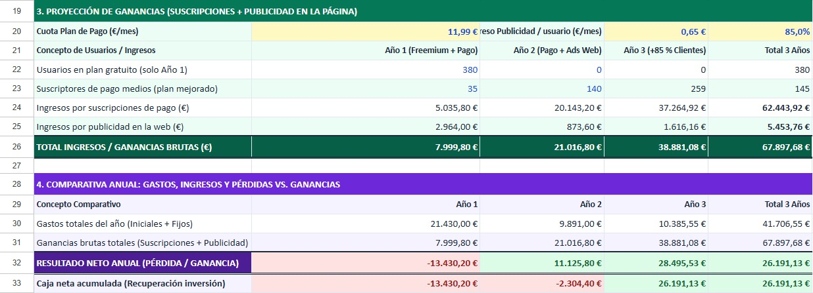

# GameMaster AI — Needs and Solutions

## Información del Proyecto y Sprint

**Proyecto:** GameMaster AI — Plataforma SaaS de Narración Inteligente por Voz para Rol (TTRPG).  
**Propuesta de Valor:** Companion App web que actúa como Narrador virtual acotado por IA para partidas de rol en PC (Tabletop Simulator). Ofrece voz narrativa en tiempo real a partir de eventos del tablero, ingesta de manuales PDF con RAG, escucha por micrófono y modelo Freemium con Stripe.  
**Solución seleccionada:** Web companion con voz bilateral e integración con Tabletop Simulator mediante Lua y webhooks.

---

## Índice

- [Información del Proyecto y Sprint](#información-del-proyecto-y-sprint)
- [1. Necesidad e investigación de jugadores](#1-necesidad-e-investigación-de-jugadores)
- [2. Benchmark y diferenciación frente al mercado](#2-benchmark-y-diferenciación-frente-al-mercado)
- [3. Propuesta de solución: GameMaster AI Companion](#3-propuesta-de-solución-gamemaster-ai-companion)
- [4. Viabilidad](#4-viabilidad)
- [5. Definición de módulos e integración (Sprint 2)](#5-definición-de-módulos-e-integración-sprint-2)
- [6. Epics and Definitions of Done](#6-epics-and-definitions-of-done)
- [7. Arquitectura de pantallas y wireframes (UI/UX)](#7-arquitectura-de-pantallas-y-wireframes-uiux)
- [8. Recursos humanos, materiales y servicios externos](#8-recursos-humanos-materiales-y-servicios-externos)
- [9. Presupuesto económico y costes de lanzamiento](#9-presupuesto-económico-y-costes-de-lanzamiento)
- [10. Bibliografía](#10-bibliografía)

---

## 1. Necesidad e investigación de jugadores

### 1.1. Perfil de jugadores y Dungeon Masters (DMs)
- **Estructura típica:** Mesas de 1 Director de Juego (DM/GM) y 3 a 5 jugadores en sesiones regulares de 3 a 4 horas.
- **División de roles:** Los jugadores buscan inmersión y dinamismo narrativo; el DM asume en solitario la preparación previa, la memorización de reglamentos y el arbitraje en vivo.
- **Herramientas en uso:** Ecosistema fragmentado (tableros virtuales como Roll20 o Tabletop Simulator, compendios digitales como D&D Beyond, canales de voz en Discord y notas dispersas). Alternar entre tantas aplicaciones rompe el ritmo de la sesión.

### 1.2. Problemas recurrentes y testimonios reales
- **Falta de jugadores y dificultad para consolidar mesas:** Problema estructural en el sector para encontrar suficientes participantes disponibles o coordinar horarios estables, lo que provoca la cancelación de campañas o impide que grupos reducidos puedan disfrutar de partidas completas.
- **Sobrecarga de preparación:** DMs invierten horas organizando tramas y encuentros que se desbaratan ante decisiones imprevistas.  
  > *«No quiero parecer que no estoy preparado cuando inevitablemente tenga que rebuscar entre las páginas para encontrar la sección adecuada...»*
- **Parones por consulta de reglas:** Búsquedas manuales en manuales densos que congelan la acción en momentos clave de combate.  
  > *«Al buscar las reglas, no encuentro nada sobre cómo liberar a los compañeros que están inmovilizados.»*
- **Fatiga de improvisación y pérdida de inmersión:** Dificultad para mantener ambientaciones creíbles ante giros inesperados.  
  > *«No se me da bien improvisar. ¿Qué puede hacer alguien a quien le cuesta inventar respuestas interesantes en el momento... sin que suene forzada?»*

### 1.3. Evidencia y justificación de urgencia
- **Datos de respaldo:** En encuestas del sector (3.663 respuestas), el **57 % de los DMs dedica 2 o más horas a preparar** cada sesión de 4 horas. En plataformas de juego virtual, *Tabletop Simulator* acumula **entre 2 y 5 millones de usuarios** con picos constantes de **~6.150 jugadores simultáneos**.
- **Justificación:** La falta de jugadores disponibles para cerrar mesas y la saturación del DM al preparar y consultar reglas en vivo son los grandes cuellos de botella que frenan las partidas de rol. La dispersión de herramientas actual fragmenta la experiencia, haciendo urgente una solución conectada que asista en tiempo real, agilice el juego y permita disfrutar de partidas dinámicas incluso con mesas reducidas.

---

## 2. Benchmark y diferenciación frente al mercado

### 2.1. Alternativas de mercado analizadas
- **[Roll20](https://roll20.net/)** (Freemium / 4,17–8,33 $/mes): Tablero VTT líder en navegador con mapas, dados y fichas. *Se limita a ser una mesa virtual; carece de narración por IA y no consulta manuales PDF propios.*
- **[D&D Beyond](https://www.dndbeyond.com/)** (Freemium / 2,17–4,58 $/mes): Plataforma oficial con visor Maps y reglas. *Ecosistema cerrado exclusivo de D&D; no admite manuales de otros juegos ni lectura semántica de documentos del usuario.*
- **[AI Dungeon](https://aidungeon.com/)** (Freemium / 9,99–29,99 $/mes): Ficción interactiva generada por IA con voz. *Pensada para historias libres; alucina con facilidad, ignora reglamentos estrictos y no interactúa con ningún tablero.*
- **[AI Game Master](https://www.aigamemaster.app/)** (Freemium / Micropagos): App móvil conversacional para partidas individuales con voz. *Enfocada a juego individual en pantalla móvil; inviable para una mesa colaborativa tradicional.*

### 2.2. Tabla comparativa de mercado

| Solución | Enfoque principal | ¿Voz en directo? | ¿RAG PDFs propios? | ¿Conexión con tablero? | Ámbito de uso |
|---|---|---|---|---|---|
| **Roll20** | Tablero VTT en navegador | Sí (chat WebRTC) | No | Sí (propio navegador) | Partidas online |
| **D&D Beyond** | Compendio oficial D&D | No | No (solo oficial D&D) | Sí (Maps integrado) | Ecosistema D&D |
| **AI Dungeon** | Ficción interactiva IA | Sí (lectura TTS) | No | No | Historias en solitario |
| **AI Game Master** | Rol en solitario en app | Sí (móvil) | No | No | Móvil individual |
| **GameMaster AI (A)** | **Narración, reglas y tablero** | **Sí (Bilateral streaming)** | **Sí (Manuales de usuario)** | **Sí (Tabletop Simulator)** | **Mesa de rol en vivo** |

### 2.3. Aspectos diferenciadores de GameMaster AI
1. **Contexto automático del tablero (Tecnología):** Recibe tiradas de dados y estado de la mesa directamente desde Tabletop Simulator, permitiendo que la IA adapte la narración sin que los jugadores tengan que teclear o dictar los resultados.
2. **RAG sobre manuales propios (Tecnología):** Respuestas normativas rigurosas con referencia exacta de página basadas únicamente en los PDFs aportados, eliminando las alucinaciones de las IAs generalistas y sirviendo para cualquier juego de rol.
3. **Flujo integrado sin cambio de ventana (Experiencia de usuario):** Combina voz en directo, resolución de reglas y visualización del tablero en una experiencia fluida que mantiene la concentración 100 % en la partida.

---

## 3. Propuesta de solución: GameMaster AI Companion

### 3.1. Descripción de la propuesta
GameMaster AI Companion es una aplicación web concebida como narrador virtual inteligente conectado a Tabletop Simulator. Está dirigida a directores de juego y grupos de rol que juegan en ordenador y buscan sesiones ágiles e inmersivas. Resuelve de forma directa los parones de consulta de reglas, la sobrecarga al improvisar y la dificultad para reunir suficientes jugadores, permitiendo disfrutar de partidas dinámicas e inmersivas incluso con grupos reducidos.

### 3.2. Flujo de uso paso a paso
1. **Preparación de la partida:** El director de juego accede a la aplicación web y carga los manuales o módulos de aventura en PDF que utilizará durante la sesión.
2. **Vinculación con el tablero:** Se inicia la sesión en Tabletop Simulator y se activa el enlace con la aplicación web para conectar la mesa de juego.
3. **Recepción de eventos en directo:** A medida que los jugadores tiran dados y mueven figuras en el tablero, la aplicación registra automáticamente los resultados y el estado de la partida.
4. **Asistencia y narración por voz:** Durante la partida, los participantes dialogan con la aplicación para resolver dudas reglamentarias o solicitar descripciones ambientales; el asistente responde por voz en tiempo real basándose en los manuales cargados y en lo ocurrido en la mesa.
5. **Cierre y memoria de sesión:** Al finalizar la partida, la aplicación recopila un resumen de eventos clave, tiradas relevantes y consultas de reglas realizadas para facilitar la continuidad en sesiones futuras.

---

## 4. Viabilidad

### 4.1. Tecnologías de GameMaster AI (Solución A)

| Componente | Tecnología elegida | Función en el sistema |
|---|---|---|
| **Frontend** | React | Interfaz web companion reactiva, rápida y optimizada para operar como pantalla de apoyo. |
| **Backend & API** | Laravel (PHP) | Lógica de negocio, gestión de sesiones, endpoints RESTful y procesamiento de webhooks. |
| **Motor de IA & Reglas** | RAG (Embeddings + BD vectorial) + API LLM | Indexación semántica de PDFs para respuestas normativas exactas con cita de página. |
| **Interacción por voz** | Web Speech API / Streaming de audio | Reconocimiento de voz (STT) y síntesis hablada (TTS) para diálogo bilateral fluido. |
| **Integración de tablero** | Scripting Lua en Tabletop Simulator | Envío ligero de eventos (`onDiceRoll`) mediante peticiones HTTP (`WebRequest.post`). |
| **Pasarela de pago** | Stripe Sandbox | Gestión de suscripciones y cobros seguros (modelo Freemium vs. Pro). |

### 4.2. Evaluación y recuento final de puntos

| Criterio clave (1 a 5 puntos) | Solución A (Companion TTS) | Solución B (Voz sin tablero) | Solución C (Texto / Campañas) |
|---|:---:|:---:|:---:|
| Inmersión y juego en vivo | 5 | 4 | 2 |
| Diferenciación frente a rivales | 5 | 4 | 3 |
| Viabilidad técnica de desarrollo | 4 | 3 | 5 |
| Control de costes y consumo | 4 | 3 | 4 |
| Potencial de monetización | 5 | 4 | 3 |
| **Recuento total de puntos** | **23 / 25** | **18 / 25** | **17 / 25** |

### 4.3. Decisión final y ordenación de la Solución A

La **Solución A (23/25)** resulta la opción ganadora. A continuación se desglosan sus ventajas y desventajas:

#### Ventajas de la Solución A
- **Inmersión y dinamismo en vivo:** Asiste por voz bilateral y reacciona de forma reactiva a las tiradas del tablero justo cuando el DM se atasca en pleno combate o escena clave.
- **Aprovechamiento de motor consolidado:** Tabletop Simulator ya resuelve el renderizado 3D, físicas de dados y miniaturas; el equipo solo necesita un script ligero en Lua de unas 10-15 líneas con `WebRequest.post` hacia Laravel.
- **Audio limpio garantizado:** El entorno de PC con auriculares y micrófono individual asegura un reconocimiento de voz nítido (STT) sin problemas de reverberación acústica ni ruidos ambientales.
- **Respuestas normativas fiables:** El motor RAG acotado cita la página exacta del manual PDF aportado, eliminando alucinaciones y disputas de reglas en la mesa.

#### Desventajas de la Solución A
- **Dependencia de software de terceros:** Requiere que los jugadores dispongan de *Tabletop Simulator* instalado en Steam para la sincronización automática del tablero.
- **Exigencia de hardware en PC:** Ejecutar Tabletop Simulator en 3D en paralelo con el navegador web requiere equipos de gama media.
- **Configuración inicial por sesión:** El director de juego debe copiar el token de sesión en el script Lua para vincular la partida virtual con la aplicación web.

#### Descarte de alternativas
- **Solución B (18/25):** Se descarta porque el reconocimiento de voz en una habitación física con múltiples personas hablando a la vez sufre graves fallos acústicos, y obligar a los jugadores a dictar verbalmente cada tirada resulta tedioso y corta el ritmo.
- **Solución C (17/25):** Se descarta porque no aporta ninguna ayuda durante la partida en vivo; se limita a ser una libreta de notas con IA que compite en desventaja frente a herramientas consolidadas como Notion o ChatGPT.

### 4.4. Limitaciones identificadas y su mitigación

Principales limitaciones técnicas de la Solución A y sus medidas de mitigación:

| Limitación identificada | Riesgo técnico | Estrategia de mitigación |
|---|---|---|
| **Latencia en voz (TTS)** | Retraso en la respuesta hablada que corta el ritmo. | Streaming de audio, LLMs rápidos (GPT-4o-mini / Gemini Flash) y respuestas breves (< 100 palabras). |
| **Desconexión de Tabletop Simulator** | Pérdida de enlace con el script Lua ante fallos de red. | Tolerancia a fallos: la web sigue 100 % operativa permitiendo registrar tiradas a mano. |
| **Alucinaciones o salida de rol** | La IA inventa reglas o responde temas ajenos. | System Prompt con Guardrails y anclaje RAG (si la regla no está en el PDF, avisa en vez de inventar). |
| **Manuales PDF extensos** | Libros de 300+ páginas que saturan la ventana de contexto. | Fragmentación semántica (*chunking*) e indexación vectorial; envío exclusivo de fragmentos clave. |
| **Sobrecoste de APIs** | Consumo imprevisto que dispare la factura de IA. | Cuotas de 15 consultas/sesión en Plan Gratuito y techos de gasto mensuales en la consola proveedora. |

---

## 5. Definición de módulos e integración

Tras la elección fundamentada de la Solución A, se define la descomposición modular y la arquitectura de integración para el desarrollo del producto:

### 5.1. Módulos funcionales

| Módulo | Función | Prioridad | ¿Entra en el MVP? |
|---|---|:---:|:---:|
| **Interfaz y voz** | Interfaz web para gestionar la sesión, consultar al asistente con *Push-to-Talk* y escuchar la respuesta con TTS. | Alta | **Sí**, con una interfaz sencilla y el flujo de voz básico. |
| **Sesiones y backend** | API en Laravel que valida solicitudes, gestiona las sesiones y coordina los módulos. | Muy alta | **Sí**; es la base necesaria para conectar y proteger el resto del sistema. |
| **Manuales y búsqueda (RAG)** | Procesa PDFs y recupera fragmentos de reglas con el número de página para citarlos. | Muy alta | **Sí**; permite que el asistente responda basándose en los manuales del grupo. |
| **Asistente de IA y Guardrails** | Combina la consulta con el contexto disponible y genera respuestas acotadas al rol y las reglas. | Muy alta | **Sí**, en una versión básica y fiable. |
| **Conector Tabletop Simulator** | Script Lua que envía a la API eventos básicos del tablero, como las tiradas de dados. | Alta | **Sí, de forma mínima**; es un diferenciador central, aunque puede desarrollarse después del flujo básico de consulta. |
| **Almacenamiento e historial** | Guarda usuarios, campañas, sesiones y eventos en una base de datos relacional. | Alta | **Sí, básico**; guardar sesiones y el contexto reciente. Los resúmenes y el historial avanzado pueden esperar. |
| **Monetización (Stripe)** | Gestiona pagos, suscripciones y planes Freemium/Pro. | Baja | **No**; se puede validar primero el producto con acceso gratuito o gestión manual. |

#### Diagrama de secuencias de integración (Flujo síncrono y asíncrono)

### 5.2. Integración entre módulos y flujos de trabajo

Toda comunicación pasa por la API de Laravel; la interfaz no accede directamente a la base de datos ni a los servicios de IA. El diagrama resume los dos flujos principales:

El DM decide cuándo solicitar una respuesta: las tiradas del tablero actualizan el contexto, pero no activan narraciones habladas automáticamente. Si el conector falla, la web puede seguir utilizándose manualmente.

### 5.3. Criterio de integración y verificación
El sistema se considera integrado cuando la interfaz web envía una consulta vinculada a una sesión activa, el backend consulta el RAG y devuelve la respuesta en texto/audio con cita de página, y los eventos de tiradas de dados desde Tabletop Simulator actualizan el contexto sin interrumpir la operatividad manual.

---

## 6. Epics and Definitions of Done

### 6.1. Backlog de Epics y User Stories

El backlog ágil se organiza en 6 Epics, cada una desglosada en User Stories concisas con sus criterios de aceptación. La columna **Plan recomendado (3 meses)** distingue las funcionalidades que conviene incluir en un MVP acotado de las que pueden posponerse. “MVP básico” indica que se implementaría solo la versión mínima necesaria.

### Epic 1: Core Web y Gestión de Sesiones

| ID | User Story | Criterios de Aceptación | Plan recomendado (3 meses) |
|:---:|---|---|---|
| **US-01** | Como DM, quiero registrarme e iniciar sesión con email y contraseña, para gestionar mis campañas de forma segura. | El usuario se registra, inicia sesión y accede a su panel privado. | MVP |
| **US-02** | Como DM, quiero crear campañas e iniciar sesiones activas, para vincular las notas y eventos a cada partida. | Permite crear campañas y abrir sesiones con un código o token. | MVP |
| **US-03** | Como DM, quiero una interfaz responsive para pantalla secundaria, para consultar la web sin estorbar el tablero. | La interfaz se adapta y maneja cómodamente en pantalla secundaria. | Secundaria: pulir la adaptación a distintos tamaños de pantalla. |

### Epic 2: Gestión de PDFs y Búsqueda RAG

| ID | User Story | Criterios de Aceptación | Plan recomendado (3 meses) |
|:---:|---|---|---|
| **US-04** | Como DM, quiero subir manuales y módulos en PDF, para que la IA disponga de las reglas de mi juego. | El usuario puede subir archivos PDF válidos a su campaña. | MVP |
| **US-05** | Como sistema, quiero fragmentar e indexar los PDFs con número de página, para realizar búsquedas semánticas precisas. | El documento queda procesado e indexado con sus páginas. | MVP |
| **US-06** | Como DM, quiero que las respuestas citen la página exacta del manual, para contrastar reglas oficiales al instante. | La respuesta indica el número de página de la regla consultada. | MVP |

### Epic 3: Motor Narrativo y Guardrails de IA

| ID | User Story | Criterios de Aceptación | Plan recomendado (3 meses) |
|:---:|---|---|---|
| **US-07** | Como grupo de rol, queremos que la IA actúe como un Dungeon Master, para recibir narraciones inmersivas. | La IA responde con tono de narrador literario y conciso. | MVP |
| **US-08** | Como DM, quiero filtros (*Guardrails*) que impidan alucinar o salir de rol, para no romper la partida. | La IA rechaza temas ajenos a la partida y no inventa reglas. | MVP básico: limitar respuestas al rol y a la información recuperada. |
| **US-09** | Como DM, quiero que la IA recuerde las tiradas y eventos recientes, para mantener coherencia narrativa. | La respuesta tiene en cuenta los últimos eventos de la mesa. | Secundaria: ampliar la memoria y coherencia entre eventos. |

### Epic 4: Interacción por Voz Bilateral (STT & TTS)

| ID | User Story | Criterios de Aceptación | Plan recomendado (3 meses) |
|:---:|---|---|---|
| **US-10** | Como DM o jugador, quiero hablar mediante *Push-to-Talk*, para consultar por voz sin recoger ruido ambiental. | Al mantener pulsado el botón se graba y transcribe la voz. | MVP básico: probar compatibilidad de reconocimiento de voz en el navegador elegido. |
| **US-11** | Como grupo, queremos escuchar la respuesta narrada en voz alta, para una experiencia inmersiva manos libres. | La aplicación reproduce la respuesta en audio de forma clara. | MVP básico: reproducir la respuesta con una voz disponible. |
| **US-12** | Como usuario, quiero un chat de texto alternativo, para continuar si falla el micrófono o altavoz. | Se pueden enviar preguntas y recibir respuestas por texto. | MVP: alternativa sencilla y respaldo para probar el flujo de IA. |

### Epic 5: Integración con Tabletop Simulator (TTS)

| ID | User Story | Criterios de Aceptación | Plan recomendado (3 meses) |
|:---:|---|---|---|
| **US-13** | Como DM, quiero vincular Tabletop Simulator con mi sesión web con un token, para enlazar el tablero con la app. | La mesa virtual se enlaza con la sesión web mediante token. | MVP básico: vincular una mesa y una sesión. |
| **US-14** | Como jugador, quiero que mis tiradas de dados en TTS se envíen solas a la web, para no tener que dictarlas. | Cada tirada de dados en el tablero se refleja en la web. | MVP básico: enviar y mostrar tiradas; limitarse inicialmente a este evento. |
| **US-15** | Como DM, quiero que la web siga activa si TTS se desconecta, para continuar la sesión manualmente. | Si el tablero se desconecta, la web sigue operativa a mano. | MVP: conservar el uso manual aunque falle la integración. |

### Epic 6: Pasarela de Pago y Suscripciones (Stripe)

| ID | User Story | Criterios de Aceptación | Plan recomendado (3 meses) |
|:---:|---|---|---|
| **US-16** | Como usuario nuevo, quiero un Plan Gratuito básico, para probar la herramienta sin coste inicial. | Permite usar la herramienta con un límite de prompts por sesión. | MVP básico: ofrecer acceso gratuito para las pruebas; el límite puede ser manual. |
| **US-17** | Como DM habitual, quiero suscribirme a un Plan Pro con Stripe, para desbloquear IA avanzada y PDFs grandes. | El pago con tarjeta procesa y activa las ventajas del Plan Pro. | Secundaria: posponer Stripe hasta validar el producto. |
| **US-18** | Como suscriptor, quiero gestionar o cancelar mi plan, para tener control sobre mi facturación. | El usuario puede consultar el estado de su plan y cancelarlo. | Secundaria: depende de implementar suscripciones de pago. |

### 6.2 Definitions of Done (Criterios globales de finalización)

Mientras que los criterios de aceptación validan individualmente cada historia de usuario, la **Definition of Done (DoD)** establece las condiciones transversales y objetivas que deben cumplirse para dar por finalizada y plenamente operativa cada Epic:

> **Criterio Transversal Global:** Todo desarrollo debe estar integrado en GitHub mediante Pull Request revisado y aprobado por pares, sin errores en consola ni en logs (`laravel.log`), con secretos protegidos en variables de entorno (`.env`) y pruebas manuales superadas.

| Epic | Definition of Done (DoD) de la Epic / Módulo |
|---|---|
| **Epic 1: Core Web y Sesiones** | Flujo completo de registro y login operativo con tokens Sanctum, CRUD de campañas persistido en base de datos, y SPA responsive en modo oscuro validada en pantalla secundaria. |
| **Epic 2: PDFs y Búsqueda RAG** | Carga y validación de manuales en PDF, pipeline de fragmentación e indexación vectorial con metadato exacto de página, y recuperación semántica de reglas verificada sin alucinaciones. |
| **Epic 3: Motor Narrativo e IA** | System Prompt de narrador de rol configurado, filtros Guardrails bloqueando preguntas ajenas a la partida, citas explícitas de manual/página e inyección de tiradas recientes en el contexto. |
| **Epic 4: Voz Bilateral (STT/TTS)** | Captura por Push-to-Talk y transcripción limpia con Web Speech API, reproducción de narración en voz alta en tiempo real y fallback automático a modo texto ante fallos de audio. |
| **Epic 5: Integración TTS** | Script Lua enviando webhooks HTTP (`onDiceRoll`) en menos de 1 s hacia Laravel, contexto actualizado en segundo plano y tolerancia a fallos garantizada si el tablero se desconecta. |
| **Epic 6: Pasarela Stripe** | Cuotas del plan Free aplicadas, checkout de Stripe Sandbox procesando cobros y activando plan Pro vía webhook (`invoice.paid`), y portal de cliente para gestión de facturas y bajas. |

---

## 7. Arquitectura de pantallas y wireframes (UI/UX)

La interfaz de GameMaster AI se organiza en cuatro pantallas en modo oscuro de alto contraste, optimizadas para servir como pantalla de apoyo durante partidas en vivo:

1. **Página principal (`/`):** Cabecera con logo, enlaces a Características, Precios y acceso; sección central con propuesta de valor y botón "Empezar"; tres columnas con las características clave; bloque de tarifas con botón "Planes"; y pie de página.
2. **Acceso (`/login` y `/register`):** Tarjeta modal con pestañas de "Inicio" y "Crear Cuenta", campos de correo y contraseña, y botón "Empezar" para acceder a la partida.
3. **Sala de partida y chat IA (`/app`):** Entorno conversacional con barra lateral organizada en partidas "En Proceso" y "Completado", zona central con el logo de la IA, barra inferior para escribir o adjuntar manuales PDF con "+", y panel de "Recientes" con el historial de eventos del tablero y respuestas con citas de reglas.
4. **Planes y suscripción (`/pricing`):** Comparativa entre el plan "Gratuito" y el plan "De Pago" con botones "Escoger" enlazados a Stripe, y sección de "Facturas" para consultar recibos e historial de cobros.

---

## 8. Recursos humanos, materiales y servicios externos

Para garantizar el desarrollo, validación y despliegue continuo de GameMaster AI bajo la metodología **Scrumban**, se definen los perfiles y responsabilidades del equipo junto con el equipamiento y servicios cloud necesarios.

### 8.1. Asignación de recursos humanos y roles

Todos los integrantes asumen tareas técnicas de desarrollo distribuidas según la arquitectura desacoplada de la plataforma. Miguel Ángel Lastra asume adicionalmente la facilitación ágil como *Scrum Master*, la gestión del repositorio y el rol de *Release Manager*.

#### Estructura del equipo y roles

#### Responsabilidades del equipo

| Miembro / Rol | Responsabilidades principales |
|---|---|
| **Miguel Ángel Lastra Garcés** *Lead Developer / Backend* | Definición de arquitectura; desarrollo de la API RESTful, autenticación, gestión de campañas, sesiones e historial; integración de pasarela de pago (Stripe Sandbox); control de versiones y releases. |
| **Abel Carbonero Mora** *Core Developer / IA y RAG* | Implementación del pipeline RAG: ingesta, fragmentación e indexación de manuales y aventuras en PDF, recuperación semántica con cita de página y ajuste del System Prompt con Guardrails. |
| **Christian Said Jimenez Mahecha** *Core Developer / Integración TTS* | Desarrollo del script Lua en Tabletop Simulator para captura de eventos del tablero (tiradas de dados) y envío asíncrono a la API de Laravel mediante peticiones HTTP (`WebRequest.post`). |
| **Rafael Riego Ruz** *Core Developer / Frontend y Voz* | Desarrollo de la SPA web optimizada como pantalla secundaria; interfaces de campañas, sesiones y planes; integración de captura por voz (STT) y síntesis narrativa hablada (TTS). |

### 8.2. Recursos materiales y servicios externos

Para la ejecución, pruebas y validación del proyecto se contempla el siguiente equipamiento físico y servicios en la nube:

#### Material y equipamiento físico

| Recurso | Uso previsto |
|---|---|
| **Estaciones de trabajo de desarrollo** | Equipos personales (PC/Mac) con entornos locales configurados: Node.js con npm para el frontend en React, PHP con Composer para el backend en Laravel y herramientas como VS Code y Git. |
| **Dispositivos de audio** | Auriculares con micrófono para probar y calibrar el reconocimiento de voz (STT) y la salida de audio (TTS), reduciendo el ruido ambiental. |
| **Licencias de software** | Copias de *Tabletop Simulator* (Steam) para desarrollar y probar scripts Lua y verificar eventos en partidas simuladas. |

#### Servicios externos e infraestructura cloud

| Servicio | Uso previsto |
|---|---|
| **Servidor web y base de datos** | Hosting VPS o cloud (por ejemplo, DigitalOcean o AWS) para desplegar el backend Laravel y la base de datos relacional (MySQL/PostgreSQL). |
| **Base de datos vectorial** | Servicio gestionado o motor vectorial (por ejemplo, Qdrant, Pinecone o pgvector) para almacenar embeddings e indexar semánticamente los manuales PDF. |
| **APIs de Inteligencia Artificial y Voz** | Modelos LLM (por ejemplo, OpenAI o Anthropic) para generar narraciones y servicios de voz (Web Speech API del navegador y streaming de audio). |
| **Pasarela de pago** | Entorno de pruebas *Stripe Sandbox* para validar el flujo de suscripciones Freemium y Pro. |

---

## 9. Presupuesto económico y costes de lanzamiento

La estrategia de marketing plantea captar clientes durante el primer año facilitando el acceso inicial a GameMaster AI y dando a conocer sus funcionalidades. Una vez creada una base de usuarios, a partir del segundo año el servicio pasará a ser de pago, quienes quieran seguir utilizando GameMaster AI deberán contratar una suscripción. Esta transición permite atraer clientes al principio y generar ingresos recurrentes para sostener el proyecto.

[Descargar o visualizar el presupuesto](./budget.xlsx)

---

## 10. Bibliografía

AI Dungeon. (s. f.). *AI Dungeon: Free-form text-based AI generated adventure game*. Latitude. https://aidungeon.com/

AI Game Master. (s. f.). *AI Game Master: Play RPG with AI*. https://www.aigamemaster.app/

Berserk Games. (2015). *Tabletop Simulator* [Juego de ordenador]. Berserk Games.

D&D Beyond. (s. f.). *Dungeons & Dragons digital toolset*. Wizards of the Coast. https://www.dndbeyond.com/

Meta (Stack Exchange Network). (2016, 21 de enero). *As a DM, what are some good ways to study in preparation for an adventure module?* Role-Playing Games Stack Exchange. https://rpg.stackexchange.com/questions/73672/as-a-dm-what-are-some-good-ways-to-study-in-preparation-for-an-adventure-module

Meta (Stack Exchange Network). (2018, 17 de septiembre). *How to add descriptive role-playing flair if I'm not good at improvising?* Role-Playing Games Stack Exchange. https://rpg.stackexchange.com/questions/133208/how-to-add-descriptive-role-playing-flair-if-im-not-good-at-improvising

Meta (Stack Exchange Network). (2020, 20 de junio). *Freeing others from webs during combat*. Role-Playing Games Stack Exchange. https://rpg.stackexchange.com/questions/169371/freeing-others-from-webs-during-combat

Roll20. (s. f.). *Roll20: Virtual tabletop for pen and paper RPGs*. The Orr Group. https://roll20.net/
