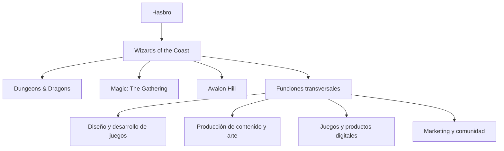
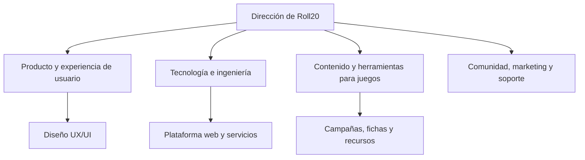
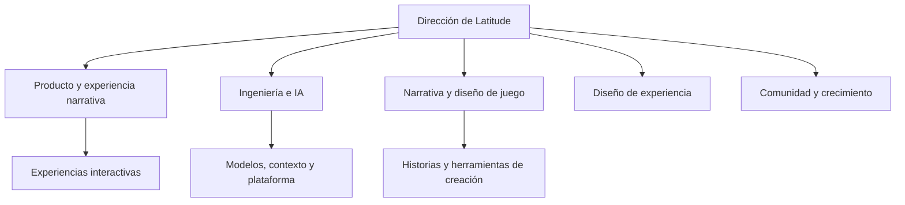

# GameMaster AI — Pitch Inicial & Análisis de Mercado

## 1. Portada y Presentación

- **Nombre de la Startup Ficticia:** GameMaster AI Studios S.L.
- **Producto Digital:** GameMaster AI (Companion App web para la narración por voz mediante IA acotada para juegos de mesa de rol en Tabletop Simulator).
- **Integrantes del Equipo:**
  - **Abel Carbonero Mora**
  - **Miguel Ángel Lastra Garcés**
  - **Christian Said Jimenez Mahecha**
  - **Rafa**
- **Curso Académico:** 2026/2027 — Proyecto Intermodular (2º DAW, ILERNA).

---

## 2. Introducción al Sector

El sector de los juegos de mesa de rol (*Tabletop Role-Playing Games* - TTRPG) y las plataformas virtuales (*Virtual Tabletops* - VTT) vive una transformación histórica impulsada por la digitalización y el auge de las tecnologías generativas.

A escala global, el mercado de las plataformas digitales de juegos de mesa alcanza una valoración de más de 3.800 millones de dólares, mientras que el mercado específico de TTRPG mueve más de 2.300 millones de dólares, con un ritmo de crecimiento (CAGR) superior al 9,6% anual.

Sin embargo, el sector enfrenta una barrera crítica de adopción: la escasez de "Game Masters" o Narradores. Crear y dirigir una campaña requiere decenas de horas de lectura de manuales de cientos de páginas, diseño de mapas y actuación. GameMaster AI nace para eliminar este cuello de botella, actuando como un Narrador virtual por voz acotado a las reglas oficiales que se integra de manera transparente con tableros virtuales como Tabletop Simulator.

## 3. Empresas analizadas y organigramas de referencia

Las empresas se estudian por su relación con el producto: una compañía de referencia en juegos de rol y propiedad intelectual, una plataforma VTT y una empresa de narrativa interactiva con IA. Los organigramas siguientes son **modelos funcionales elaborados para este proyecto**; no son organigramas oficiales ni afirman reproducir puestos internos concretos.

### 3.1. Wizards of the Coast — empresa grande

Wizards of the Coast es una filial de Hasbro y desarrolla juegos de rol, juegos de cartas coleccionables y videojuegos. Entre sus marcas más reconocidas están *Dungeons & Dragons*, *Magic: The Gathering* y Avalon Hill. Su perfil público en LinkedIn indica un tamaño de 501–1.000 empleados; se usa como referencia orientativa, ya que las plantillas y los rangos publicados pueden cambiar.

**Análisis como referencia**

- **Fortalezas:** marcas consolidadas, universos narrativos reconocibles, reglas y contenidos extensos, y comunidades de jugadores que mantienen el interés por sus juegos.
- **Relación con GameMaster AI:** es una referencia para organizar campañas, ambientación y materiales de juego. La plataforma podría permitir que cada grupo cargue sus propios documentos y consulte ese contenido durante la partida.
- **Aprendizaje aplicable:** dar prioridad a la coherencia entre narrativa y reglas, y facilitar que el director de juego encuentre rápidamente información relevante.
- **Diferencia de escala:** GameMaster AI no pretende crear ni sustituir una editorial de juegos; se plantea como herramienta complementaria para dirigir partidas.

**Organigrama funcional de referencia**

### 3.2. Roll20 — empresa mediana

Roll20 es una plataforma web para jugar partidas de rol y otros juegos de mesa en línea. Su producto ofrece herramientas para organizar campañas, gestionar personajes y recursos, y utilizar dados integrados. Su perfil público en LinkedIn indica un tamaño de 51–200 empleados. La clasificación como empresa mediana se mantiene como referencia para el trabajo y no como una afirmación sobre su categoría legal.

**Análisis como referencia**

- **Fortalezas:** acceso desde el navegador, herramientas reunidas en un mismo espacio y funciones pensadas para coordinar una partida a distancia.
- **Relación con GameMaster AI:** es la referencia más directa para la experiencia de uso durante una sesión. GameMaster AI puede complementar un VTT con narración, escucha por voz, contexto y consulta de documentos, en lugar de intentar reemplazar el tablero.
- **Aprendizaje aplicable:** priorizar una interfaz legible mientras se juega, una navegación rápida entre campañas y sesiones, y una integración que no interrumpa el flujo de la partida.
- **Oportunidad de diferenciación:** enfocar el producto en el papel de Dungeon Master asistido por IA y en mantener la respuesta vinculada a las fuentes de la campaña.

**Organigrama funcional de referencia**

### 3.3. Latitude Inc. — empresa pequeña, referencia de narrativa con IA

Latitude se toma como referencia de una empresa de menor escala centrada en experiencias de narrativa interactiva con IA, especialmente por *AI Dungeon*. La web de *AI Dungeon* presenta una experiencia de aventura narrativa generada por IA, en la que las decisiones del jugador influyen en la historia. No se ha encontrado una cifra pública fiable de plantilla para confirmar el tamaño; por ello, «pequeña» se conserva como la clasificación asignada en este proyecto, no como un dato verificado.

**Aclaración sobre AI Game Master:** no se ha podido confirmar que la aplicación *AI Game Master - Dungeon RPG* pertenezca a Latitude. La ficha de la App Store consultada identifica a **Digital Dynasty Entertainment** como desarrollador. Por tanto, en este análisis se trata a Latitude como referencia de narrativa interactiva con IA y a *AI Game Master* como una referencia de producto independiente, salvo que el equipo tenga otra fuente que acredite la relación.

**Análisis como referencia**

- **Fortalezas:** uso de IA para generar historias abiertas, adaptación de la narración a las acciones del jugador y una experiencia centrada en la creatividad y la interacción.
- **Relación con GameMaster AI:** sirve para estudiar cómo hacer que una conversación con IA se sienta dinámica. El proyecto se diferencia al enfocarse en partidas de mesa, documentos de reglas y aventuras aportados por los usuarios, contexto persistente y una posible integración con Tabletop Simulator.
- **Aprendizaje aplicable:** responder a las acciones del jugador manteniendo continuidad narrativa, sin perder de vista límites, fuentes y contexto.
- **Riesgo que se debe controlar:** una historia generativa puede inventar detalles. GameMaster AI debe distinguir entre narración creativa y reglas/documentos verificables, y reconocer cuando no encuentra información suficiente.

**Organigrama funcional de referencia**

### 3.4. Comparativa y aplicación al proyecto

| Referencia | Aportación principal | Qué puede aprender GameMaster AI |
| --- | --- | --- |
| Wizards of the Coast | Juegos, reglas, mundos y marcas de rol | Organizar el contenido de campaña y respetar la coherencia del universo y sus reglas |
| Roll20 | Herramientas web para organizar partidas | Diseñar una interfaz rápida, útil durante la sesión y complementaria al tablero |
| Latitude / *AI Dungeon* | Narrativa interactiva apoyada por IA | Mantener una historia dinámica con contexto, límites y control sobre las respuestas |
| *AI Game Master - Dungeon RPG* | Referencia de producto con narrador de IA | Observar funciones de narración, juego de rol y voz; su ficha consultada atribuye la app a Digital Dynasty Entertainment |

La propuesta de GameMaster AI combina estas referencias sin replicar una sola: toma la organización y consistencia del contenido de juegos de rol, la usabilidad de un VTT y la interacción narrativa de una IA. Su elemento diferenciador será fundamentar las respuestas en los documentos de cada campaña y conectarlas con los eventos de la partida.

