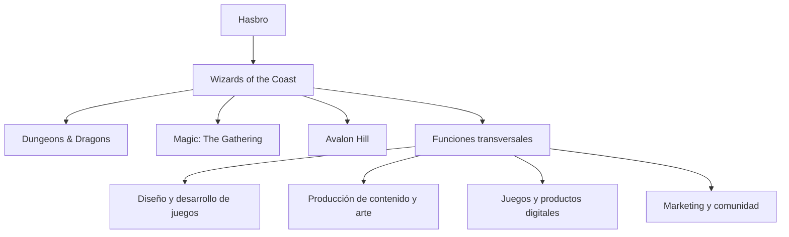
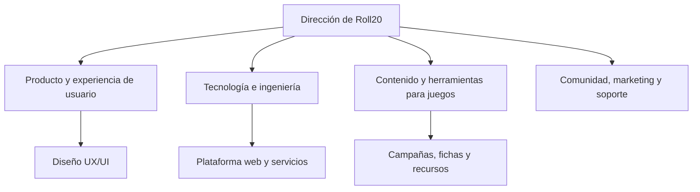
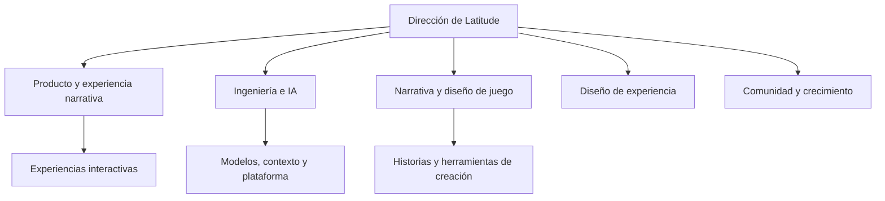

# GameMaster AI — Pitch Inicial & Análisis de Mercado

---

## Portada y Presentación

| Parámetro | Detalle |
| :--- | :--- |
| **Startup Ficticia** | **GameMaster AI Studios S.L.** |
| **Producto Digital** | **GameMaster AI** — SaaS Companion App Web para narración inteligente por voz con IA acotada para juegos de mesa de rol, integrable con Tabletop Simulator |
| **Equipo de Desarrollo** | **Abel Carbonero Mora**<br/>**Miguel Ángel Lastra Garcés**<br/>**Christian Said Jimenez Mahecha**<br/>**Rafa** |
| **Ciclo Formativo** | 2º DAW (Desarrollo de Aplicaciones Web) — ILERNA (2026/2027)<br/>*Módulos: DWS, DWC, DIW, DA, IPE II, IP, PI* |

---

## Índice

- [1. Introducción al Sector y Propuesta de Valor](#1-introducción-al-sector-y-propuesta-de-valor)
- [2. Empresas Analizadas y Organigramas de Referencia](#2-empresas-analizadas-y-organigramas-de-referencia)
  - [2.1. Wizards of the Coast (Gran Empresa)](#21-wizards-of-the-coast-gran-empresa)
  - [2.2. Roll20 (Mediana Empresa)](#22-roll20-mediana-empresa)
  - [2.3. Latitude Inc. (Pequeña Empresa)](#23-latitude-inc-pequeña-empresa)
  - [2.4. Comparativa y Aplicación al Proyecto](#24-comparativa-y-aplicación-al-proyecto)
- [3. Organigrama de GameMaster AI](#3-organigrama-de-gamemaster-ai)

---

## 1. Introducción al Sector y Propuesta de Valor

El sector de los juegos de mesa de rol (*Tabletop Role-Playing Games* - TTRPG) y las plataformas virtuales (*Virtual Tabletops* - VTT) vive una transformación histórica impulsada por la digitalización y el auge de las tecnologías generativas.

- **Mercado Global VTT & Digital:** Valoración superior a **3.800 millones de dólares**.
- **Mercado Específico TTRPG:** Movimiento estimado en más de **2.300 millones de dólares**, con un ritmo de crecimiento (**CAGR**) superior al **9,6%** anual.
- **Cuello de Botella Crítico:** La escasez de "Game Masters" o Directores de Juego. Dirigir una campaña exige decenas de horas de lectura de extensos manuales, diseño de escenarios y cálculo de reglas.

> [!NOTE]
> **Misión y Propuesta de Valor:** GameMaster AI es una **SaaS Companion App Web** concebida para actuar como un Narrador virtual por voz acotado por IA. Ingiere reglamentos y módulos en PDF, escucha las acciones de los jugadores por micrófono (Web Speech API) y responde narrando en tiempo real, integrándose de forma transparente con el tablero virtual de **Tabletop Simulator** mediante scripts en Lua y Webhooks automáticos.

---

## 2. Empresas Analizadas y Organigramas de Referencia

Las empresas se analizan por su relación estratégica con el producto: una compañía de referencia en propiedad intelectual y manuales de rol, una plataforma VTT consolidada en el navegador y un referente de narrativa interactiva impulsada por IA.

> [!NOTE]
> Los organigramas mostrados a continuación son **modelos funcionales elaborados para este proyecto** a modo de referencia orientativa y no corresponden a organigramas oficiales internos.

### 2.1. Wizards of the Coast (Gran Empresa)

Wizards of the Coast es una filial de Hasbro y referente mundial en el desarrollo de juegos de rol, cartas coleccionables y videojuegos. Cuenta con franquicias insignia como *Dungeons & Dragons*, *Magic: The Gathering* y *Avalon Hill*, con una plantilla de referencia estimada en LinkedIn de entre 501 y 1.000 empleados.

#### Análisis como referencia

- **Fortalezas:** Marcas consolidadas, universos narrativos de amplio recorrido, manuales reglados exhaustivos y comunidades masivas de jugadores activos.
- **Relación con GameMaster AI:** Referente en estructuración de campañas, ambientación y lore. La plataforma web permitirá que los usuarios suban sus manuales en PDF y consulten datos canónicos en tiempo real.
- **Aprendizaje aplicable:** Priorizar la coherencia absoluta entre narrativa y reglas vigentes, permitiendo indexar y localizar información clave de forma inmediata.
- **Diferencia de escala:** GameMaster AI no busca crear ni sustituir una editorial de contenidos, sino actuar como herramienta web complementaria para la dirección de partidas.

#### Organigrama funcional de referencia



### 2.2. Roll20 (Mediana Empresa)

Roll20 es la plataforma web de referencia para partidas de rol y juegos de mesa en remoto. Ofrece un espacio integral accesible desde el navegador con gestión de fichas de personaje, mapas, audio y dados digitales. Su plantilla estimada en LinkedIn se sitúa en el rango de 51 a 200 empleados.

#### Análisis como referencia

- **Fortalezas:** Accesibilidad universal vía navegador web, centralización de herramientas de gestión de mesa y facilidad de coordinación de partidas a distancia.
- **Relación con GameMaster AI:** Constituye la referencia más directa de experiencia de usuario en navegador. GameMaster AI actúa como companion app web optimizada para pantalla secundaria, aportando narración por voz y contexto sin interferir con la mesa de juego.
- **Aprendizaje aplicable:** Diseñar una interfaz web ligera, temática y responsive (React) que facilite una navegación rápida y no interrumpa el ritmo de la partida en el ordenador.
- **Oportunidad de diferenciación:** Especializarse en la figura del Narrador asistido por IA acotada (RAG), garantizando respuestas estrictamente fidedignas a los documentos aportados y enlazadas con los eventos de Tabletop Simulator.

#### Organigrama funcional de referencia



### 2.3. Latitude Inc. (Pequeña Empresa)

Latitude representa una compañía ágil especializada en experiencias de narrativa interactiva impulsadas por modelos de lenguaje generativos, destacando por su producto web *AI Dungeon*. Permite a los usuarios sumergirse en aventuras narrativas donde las acciones del jugador modifican dinámicamente la historia.

> [!NOTE]
> **Aclaración sobre AI Game Master:** *AI Game Master - Dungeon RPG* es una app móvil comercial independiente desarrollada por Digital Dynasty Entertainment en tiendas de aplicaciones. Se toma únicamente como referencia externa de interacción por voz en el mercado. En contraposición, **GameMaster AI es una plataforma SaaS 100% Web (React + Laravel)** concebida para utilizarse desde el navegador en PC como pantalla de apoyo durante partidas virtuales en Tabletop Simulator.

#### Análisis como referencia

- **Fortalezas:** Generación de historias dinámicas no lineales, adaptabilidad a la creatividad de los jugadores y experiencia conversacional fluida.
- **Relación con GameMaster AI:** Permite estudiar dinámicas conversacionales ágiles con IA. GameMaster AI se diferencia al centrarse en partidas regladas, persistencia relacional del estado de la campaña y sincronización con el tablero de Tabletop Simulator.
- **Aprendizaje aplicable:** Mantener continuidad narrativa coherente entre intervenciones sucesivas respetando los límites del escenario.
- **Riesgo que se debe controlar:** La alucinación de contenido. GameMaster AI implementa *Guardrails* y un *System Prompt* estricto que acotan la IA a responder exclusivamente según los manuales PDF indexados, impidiendo desviaciones a temas ajenos a la partida.

#### Organigrama funcional de referencia



### 2.4. Comparativa y Aplicación al Proyecto

| Referencia | Formato / Enfoque | Aportación principal | Qué aprende y cómo se diferencia GameMaster AI |
| :--- | :--- | :--- | :--- |
| **Wizards of the Coast** | Gran editorial internacional | Reglas oficiales, ambientación y lore de campañas | GameMaster AI incorpora indexación semántica (RAG) de manuales PDF para mantener fidelidad reglamentaria estricta |
| **Roll20** | Plataforma SaaS Web (VTT) | Herramientas web para organizar partidas en navegador | GameMaster AI adopta una arquitectura web desacoplada (React + Laravel) ágil y pensada como pantalla secundaria |
| **Latitude (*AI Dungeon*)** | Plataforma de narrativa con IA | Historias dinámicas y generación de texto interactivo | GameMaster AI aplica *Guardrails* estrictos para evitar alucinaciones y ceñirse al escenario cargado |
| ***AI Game Master* (Externa)** | App móvil comercial nativa | Interacción por voz y ambientación sonora en tiendas móviles | Referencia de voz; GameMaster AI se diferencia como solución **SaaS Web** integrada con **Tabletop Simulator** vía Lua y Webhooks |

> [!NOTE]
> **Conclusión Estratégica:** GameMaster AI integra las fortalezas de cada referencia: adopta el rigor reglamentario de las grandes editoriales de rol, la accesibilidad de una solución web moderna tipo SaaS (React/Laravel), la inmersión por voz y la interacción de modelos LLM acotados. Su gran elemento diferenciador radica en la ingesta de PDFs de la propia mesa y la comunicación bidireccional en tiempo real con Tabletop Simulator.

---

## 3. Organigrama de GameMaster AI

El organigrama funcional de **GameMaster AI Studios** se estructura a partir de las áreas funcionales de la empresa y los módulos clave de la plataforma web, siguiendo el mismo modelo organizativo de las compañías de referencia. 

Esta estructura distribuye las funciones del producto bajo la coordinación de **Miguel Ángel Lastra Garcés** (Lead Developer, Revisor de Código, Scrum Master y Release Manager) junto al equipo de programadores íntegros (*Core Developers*) asignados a cada dominio técnico:

```mermaid
flowchart TD
    GM[Dirección de GameMaster AI Studios] --> FE[Frontend & Experiencia Web]
    GM --> BE[Backend & Persistencia]
    GM --> IA[Motor de IA & RAG]
    GM --> IT[Integración VTT & Negocio]

    FE --> FE1[Companion App React y voz Web Speech API]
    BE --> BE1[API RESTful Laravel y gestión de campañas]
    IA --> IA1[Procesamiento de PDFs y LLM con Guardrails]
    IT --> IT1[Conexión Tabletop Simulator y pagos Stripe]
    ```

## 5. Descripción de departamentos y funciones

# Descripción de departamentos y funciones de las empresas

## Índice

1. [Wizards of the Coast](#1-wizards-of-the-coast)
2. [Roll20](#2-roll20)
3. [Latitude Inc.](#3-latitude-inc)
4. [AI Game Master](#4-ai-game-master)
5. [Comparación general](#5-comparación-general)
6. [Conclusión](#6-conclusión)
7. [Fuentes](#7-fuentes)

---

## 1. Wizards of the Coast

### Departamentos y funciones

| Departamento | Funciones principales | Relevancia para la empresa |
|---|---|---|
| Diseño y desarrollo de juegos | Crea reglas, mecánicas, personajes, escenarios y expansiones. Realiza pruebas para equilibrar el juego. | Es el núcleo creativo del negocio y permite desarrollar productos atractivos. |
| Arte y diseño gráfico | Diseña ilustraciones, personajes, cartas, manuales, cajas y otros elementos visuales. | Da identidad visual a los juegos y aumenta su atractivo. |
| Producción y publicación | Coordina la fabricación de cartas, libros y otros productos, así como su preparación para el lanzamiento. | Garantiza que los productos estén disponibles con la calidad prevista. |
| Marketing y comunicación | Organiza campañas publicitarias, promociona novedades y comunica lanzamientos. | Genera interés, impulsa las ventas y fortalece las marcas. |
| Ventas y distribución | Gestiona la comercialización mediante tiendas, distribuidores y otros canales. | Permite que los productos lleguen a los consumidores y genera ingresos. |
| Comunidad y eventos | Organiza actividades, torneos y programas de juego, y colabora con comunidades de jugadores. | Fideliza a los clientes y mantiene activa la comunidad. |
| Tecnología y desarrollo digital | Mantiene plataformas digitales, herramientas en línea y productos tecnológicos relacionados con los juegos. | Amplía las formas de jugar y permite llegar a nuevos públicos. |
| Finanzas y administración | Controla presupuestos, ingresos, costes e inversiones. | Ayuda a mantener la rentabilidad y planificar futuros lanzamientos. |
| Recursos humanos | Gestiona la contratación, formación y desarrollo profesional de los trabajadores. | Permite contar con los profesionales necesarios. |
| Legal y propiedad intelectual | Gestiona licencias, marcas registradas, derechos de autor y contratos. | Protege las creaciones y sus derechos comerciales. |

**Contribución al negocio:** los departamentos creativos desarrollan los juegos; producción y distribución los llevan al mercado; y marketing, ventas y comunidad mantienen el interés de los consumidores.

---

## 2. Roll20

### Departamentos y funciones

| Departamento | Funciones principales | Relevancia para la empresa |
|---|---|---|
| Desarrollo de software | Programa y mantiene la plataforma, implementa nuevas funciones y corrige errores. | Garantiza el funcionamiento del servicio. |
| Diseño UX/UI | Diseña la interfaz y organiza las herramientas para que sean intuitivas. | Mejora la experiencia de jugadores y directores de juego. |
| Infraestructura y operaciones técnicas | Supervisa los servidores, el rendimiento, la disponibilidad y la escalabilidad. | Permite que las partidas en línea funcionen de forma estable. |
| Gestión de producto | Define prioridades, analiza las necesidades de los usuarios y planifica mejoras. | Ayuda a desarrollar funciones útiles y competitivas. |
| Contenidos y catálogo | Organiza mapas, fichas, recursos digitales y materiales oficiales o de colaboradores. | Aumenta las posibilidades de juego. |
| Marketing y comunicación | Promociona la plataforma, comunica novedades y atrae nuevos usuarios. | Incrementa la visibilidad y favorece el crecimiento. |
| Ventas y alianzas comerciales | Gestiona acuerdos con editoriales, licencias y contenidos de pago. | Amplía el catálogo y genera ingresos. |
| Atención al cliente | Resuelve dudas y problemas técnicos relacionados con cuentas, suscripciones y funciones. | Mejora la satisfacción y fidelización. |
| Comunidad y moderación | Gestiona espacios comunitarios y fomenta un entorno adecuado. | Mantiene una comunidad activa. |
| Administración, finanzas y recursos humanos | Controla ingresos, gastos, suscripciones y organización del personal. | Favorece la sostenibilidad económica. |
| Seguridad y protección de datos | Protege las cuentas, los datos de usuarios y los sistemas de la plataforma. | Reduce riesgos y refuerza la confianza. |

**Contribución al negocio:** el desarrollo y las operaciones técnicas mantienen la plataforma disponible, mientras que producto, contenidos, marketing y atención al cliente mejoran la experiencia y favorecen la fidelización.

---

## 3. Latitude Inc.

### Departamentos y funciones

| Departamento | Funciones principales | Relevancia para la empresa |
|---|---|---|
| Diseño de juegos y narrativa | Define mundos, personajes, misiones, reglas y experiencias narrativas. | Hace que los juegos sean interesantes y ofrezcan libertad de elección. |
| Investigación y desarrollo de IA | Investiga y mejora los sistemas de inteligencia artificial que generan historias y respuestas. | Diferencia sus productos de los juegos tradicionales. |
| Ingeniería de software | Desarrolla aplicaciones, interfaces, sistemas de cuentas y herramientas para los jugadores. | Convierte la tecnología en un producto funcional. |
| Infraestructura y sistemas | Gestiona servicios en la nube, capacidad de procesamiento, rendimiento y costes técnicos. | Mantiene la estabilidad y controla los costes de la IA. |
| Diseño de producto y experiencia de usuario | Analiza cómo juegan los usuarios y mejora las funciones y la facilidad de uso. | Favorece la satisfacción y la continuidad de uso. |
| Arte y generación multimedia | Desarrolla o integra imágenes y otros recursos visuales generados mediante IA. | Enriquece la experiencia y hace los mundos más inmersivos. |
| Control de calidad y evaluación de IA | Prueba los juegos, detecta errores y evalúa la coherencia de las historias. | Mejora la calidad y reduce fallos. |
| Comunidad y atención al usuario | Recoge opiniones, responde a incidencias y mantiene la comunicación con los jugadores. | Permite conocer las necesidades de los usuarios. |
| Marketing y crecimiento | Promociona los juegos, desarrolla campañas y busca nuevos públicos. | Aumenta la visibilidad y el número de jugadores. |
| Finanzas y monetización | Gestiona presupuestos, suscripciones, compras y costes de infraestructura. | Ayuda a mantener la rentabilidad. |
| Legal, privacidad y seguridad | Gestiona condiciones de uso, propiedad intelectual, protección de datos y riesgos relacionados con la IA. | Favorece el cumplimiento legal y un uso responsable. |

**Contribución al negocio:** la investigación de IA, la ingeniería y el diseño narrativo crean experiencias interactivas. La infraestructura y las finanzas permiten mantenerlas a un coste sostenible.

---

## 4. AI Game Master

### Departamentos y funciones

| Departamento | Funciones principales | Relevancia para la empresa |
|---|---|---|
| Diseño de videojuegos y narrativa | Diseña aventuras, personajes, mundos, misiones, combates y reglas. | Define la identidad del juego y la calidad de las aventuras. |
| Desarrollo de inteligencia artificial | Integra modelos de IA para generar narraciones, diálogos y acontecimientos adaptados a las decisiones del jugador. | Es el núcleo tecnológico de las historias dinámicas. |
| Desarrollo de aplicaciones | Programa y mantiene la aplicación móvil, sus funciones y la conexión con los servicios de IA. | Permite acceder al juego y utilizar sus funciones. |
| Arte y contenido multimedia | Crea o integra imágenes, escenarios y recursos visuales generados mediante IA. | Mejora la presentación visual y la inmersión. |
| Control de calidad y pruebas | Comprueba el funcionamiento, detecta errores y evalúa la calidad de las respuestas de la IA. | Evita problemas técnicos y mejora la experiencia. |
| Diseño UX/UI | Organiza los menús, las pantallas, la creación de personajes y las opciones de interacción. | Facilita el uso de la aplicación. |
| Marketing y comunicación | Promociona el juego en tiendas de aplicaciones, redes sociales y comunidades. | Ayuda a conseguir nuevos jugadores. |
| Comunidad y soporte técnico | Responde a consultas, recoge sugerencias y comunica problemas al equipo de desarrollo. | Permite identificar necesidades y mejorar el producto. |
| Gestión económica y monetización | Administra compras integradas, posibles planes de pago, presupuestos y costes de IA. | Ayuda a financiar el desarrollo y mantener el juego. |
| Administración, legal y privacidad | Gestiona condiciones de uso, pagos, propiedad intelectual y protección de datos. | Favorece el cumplimiento legal y la confianza de los usuarios. |

**Contribución al negocio:** el diseño narrativo y la IA generan las aventuras, mientras que el desarrollo y las pruebas garantizan el funcionamiento. Marketing, soporte y monetización ayudan a mantener y ampliar el producto.

---

## 5. Comparación general

| Empresa | Actividad principal | Departamentos más estratégicos |
|---|---|---|
| Wizards of the Coast | Creación y comercialización de juegos de cartas, rol y productos digitales. | Diseño de juegos, arte, producción, marketing y distribución. |
| Roll20 | Plataforma en línea para jugar partidas de rol y juegos de mesa. | Desarrollo de software, infraestructura, diseño UX/UI y gestión de producto. |
| Latitude Inc. | Desarrollo de experiencias narrativas interactivas mediante IA. | Investigación de IA, ingeniería, diseño narrativo e infraestructura. |
| AI Game Master | Videojuego de rol con aventuras generadas mediante IA. | Desarrollo de aplicaciones, inteligencia artificial, narrativa y control de calidad. |

---

## 6. Conclusión

Aunque las cuatro empresas están relacionadas con los juegos y el entretenimiento, cada una necesita priorizar departamentos diferentes según su actividad.

- **Wizards of the Coast** depende especialmente de la creatividad, el diseño de juegos, la producción y la distribución.
- **Roll20** necesita una plataforma tecnológica estable, fácil de utilizar y capaz de conectar a jugadores de diferentes lugares.
- **Latitude Inc.** destaca por la investigación en inteligencia artificial y el desarrollo de sistemas narrativos interactivos.
- **AI Game Master** combina programación, inteligencia artificial y diseño narrativo para ofrecer aventuras personalizadas.

En conclusión, todos los departamentos contribuyen al funcionamiento de una empresa. Los departamentos de desarrollo de producto y tecnología son especialmente importantes en las plataformas digitales y los videojuegos basados en IA, mientras que marketing, finanzas, soporte y administración permiten transformar los productos en negocios sostenibles.

---

## 7. Fuentes

- **Wizards of the Coast:** [Web corporativa](https://company.wizards.com/es/who-we-are)
- **Roll20:** [Web oficial](https://roll20.net/) | [Centro de ayuda](https://help.roll20.net/)
- **Latitude Inc.:** [Información corporativa](https://latitude.io/press)
- **AI Game Master:** [Web oficial](https://www.aigamemaster.app/about)

> **Nota metodológica:** las fuentes describen las actividades y los productos de las empresas. La clasificación de departamentos es un análisis funcional elaborado para este trabajo y no implica que cada empresa publique un organigrama con todas estas áreas. Algunas funciones pueden estar agrupadas en un mismo equipo o externalizadas.


## 6. Necesidades y volumen de negocio.
=======
    FE --> FE1[Companion App React y voz Web Speech API]
    BE --> BE1[API RESTful Laravel y gestión de campañas]
    IA --> IA1[Procesamiento de PDFs y LLM con Guardrails]
    IT --> IT1[Conexión Tabletop Simulator y pagos Stripe]
```
