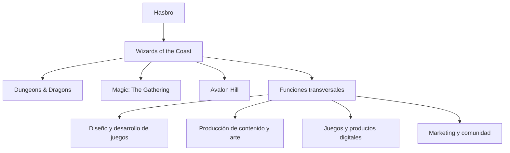
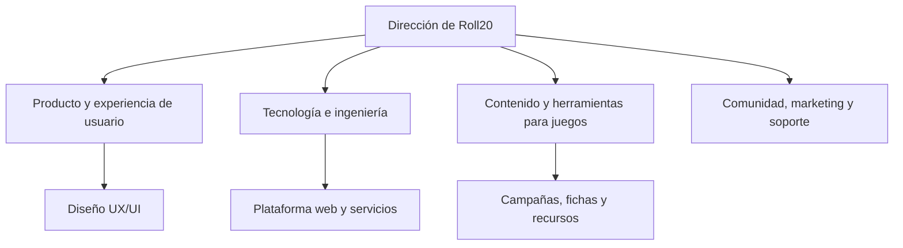
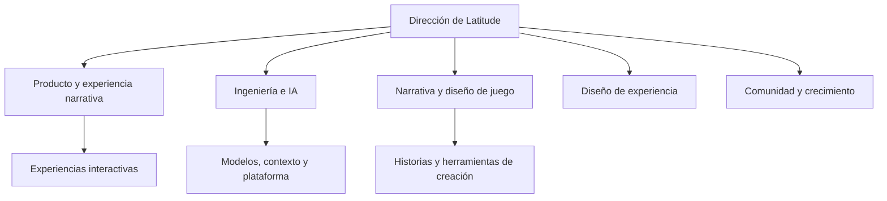
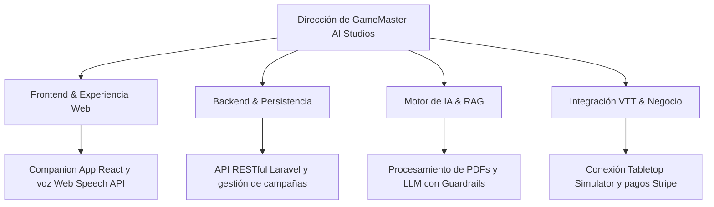

# GameMaster AI — Pitch Inicial & Análisis de Mercado

---

## Portada y Presentación

| Parámetro | Detalle |
| :--- | :--- |
| **Startup Ficticia** | **GameMaster AI Studios S.L.** |
| **Producto Digital** | **GameMaster AI** — SaaS Companion App Web para narración inteligente por voz con IA acotada para juegos de mesa de rol, integrable con Tabletop Simulator |
| **Equipo de Desarrollo** | **Abel Carbonero Mora** **Miguel Ángel Lastra Garcés** **Christian Said Jimenez Mahecha** **Rafa** |
| **Ciclo Formativo** | 2º DAW (Desarrollo de Aplicaciones Web) — ILERNA (2026/2027) *Módulos: DWS, DWC, DIW, DA, IPE II, IP, PI* |

---

## Índice

- [1. Introducción al Sector y Propuesta de Valor](#1-introducción-al-sector-y-propuesta-de-valor)
- [2. Empresas Analizadas y Organigramas de Referencia](#2-empresas-analizadas-y-organigramas-de-referencia)
  - [2.1. Wizards of the Coast (Gran Empresa)](#21-wizards-of-the-coast-gran-empresa)
  - [2.2. Roll20 (Mediana Empresa)](#22-roll20-mediana-empresa)
  - [2.3. Latitude Inc. (Pequeña Empresa)](#23-latitude-inc-pequeña-empresa)
  - [2.4. Comparativa y Aplicación al Proyecto](#24-comparativa-y-aplicación-al-proyecto)
- [3. Organigrama de GameMaster AI](#3-organigrama-de-gamemaster-ai)

---

## 1. Introducción al Sector y Propuesta de Valor

El sector de los juegos de mesa de rol (*Tabletop Role-Playing Games* - TTRPG) y las plataformas virtuales (*Virtual Tabletops* - VTT) vive una transformación histórica impulsada por la digitalización y el auge de las tecnologías generativas.

- **Mercado Global VTT & Digital:** Valoración superior a **3.800 millones de dólares**.
- **Mercado Específico TTRPG:** Movimiento estimado en más de **2.300 millones de dólares**, con un ritmo de crecimiento (**CAGR**) superior al **9,6%** anual.
- **Cuello de Botella Crítico:** La escasez de "Game Masters" o Directores de Juego. Dirigir una campaña exige decenas de horas de lectura de extensos manuales, diseño de escenarios y cálculo de reglas.

> [!NOTE]
> **Misión y Propuesta de Valor:** GameMaster AI es una **SaaS Companion App Web** concebida para actuar como un Narrador virtual por voz acotado por IA. Ingiere reglamentos y módulos en PDF, escucha las acciones de los jugadores por micrófono (Web Speech API) y responde narrando en tiempo real, integrándose de forma transparente con el tablero virtual de **Tabletop Simulator** mediante scripts en Lua y Webhooks automáticos.

---

## 2. Empresas Analizadas y Organigramas de Referencia

Las empresas se analizan por su relación estratégica con el producto: una compañía de referencia en propiedad intelectual y manuales de rol, una plataforma VTT consolidada en el navegador y un referente de narrativa interactiva impulsada por IA.

> [!NOTE]
> Los organigramas mostrados a continuación son **modelos funcionales elaborados para este proyecto** a modo de referencia orientativa y no corresponden a organigramas oficiales internos.

### 2.1. Wizards of the Coast (Gran Empresa)

Wizards of the Coast es una filial de Hasbro y referente mundial en el desarrollo de juegos de rol, cartas coleccionables y videojuegos. Cuenta con franquicias insignia como *Dungeons & Dragons*, *Magic: The Gathering* y *Avalon Hill*, con una plantilla de referencia estimada en LinkedIn de entre 501 y 1.000 empleados.

#### Análisis como referencia

- **Fortalezas:** Marcas consolidadas, universos narrativos de amplio recorrido, manuales reglados exhaustivos y comunidades masivas de jugadores activos.
- **Relación con GameMaster AI:** Referente en estructuración de campañas, ambientación y lore. La plataforma web permitirá que los usuarios suban sus manuales en PDF y consulten datos canónicos en tiempo real.
- **Aprendizaje aplicable:** Priorizar la coherencia absoluta entre narrativa y reglas vigentes, permitiendo indexar y localizar información clave de forma inmediata.
- **Diferencia de escala:** GameMaster AI no busca crear ni sustituir una editorial de contenidos, sino actuar como herramienta web complementaria para la dirección de partidas.

#### Organigrama funcional de referencia

### 2.2. Roll20 (Mediana Empresa)

Roll20 es la plataforma web de referencia para partidas de rol y juegos de mesa en remoto. Ofrece un espacio integral accesible desde el navegador con gestión de fichas de personaje, mapas, audio y dados digitales. Su plantilla estimada en LinkedIn se sitúa en el rango de 51 a 200 empleados.

#### Análisis como referencia

- **Fortalezas:** Accesibilidad universal vía navegador web, centralización de herramientas de gestión de mesa y facilidad de coordinación de partidas a distancia.
- **Relación con GameMaster AI:** Constituye la referencia más directa de experiencia de usuario en navegador. GameMaster AI actúa como companion app web optimizada para pantalla secundaria, aportando narración por voz y contexto sin interferir con la mesa de juego.
- **Aprendizaje aplicable:** Diseñar una interfaz web ligera, temática y responsive (React) que facilite una navegación rápida y no interrumpa el ritmo de la partida en el ordenador.
- **Oportunidad de diferenciación:** Especializarse en la figura del Narrador asistido por IA acotada (RAG), garantizando respuestas estrictamente fidedignas a los documentos aportados y enlazadas con los eventos de Tabletop Simulator.

#### Organigrama funcional de referencia

### 2.3. Latitude Inc. (Pequeña Empresa)

Latitude representa una compañía ágil especializada en experiencias de narrativa interactiva impulsadas por modelos de lenguaje generativos, destacando por su producto web *AI Dungeon*. Permite a los usuarios sumergirse en aventuras narrativas donde las acciones del jugador modifican dinámicamente la historia.

> [!NOTE]
> **Aclaración sobre AI Game Master:** *AI Game Master - Dungeon RPG* es una app móvil comercial independiente desarrollada por Digital Dynasty Entertainment en tiendas de aplicaciones. Se toma únicamente como referencia externa de interacción por voz en el mercado. En contraposición, **GameMaster AI es una plataforma SaaS 100% Web (React + Laravel)** concebida para utilizarse desde el navegador en PC como pantalla de apoyo durante partidas virtuales en Tabletop Simulator.

#### Análisis como referencia

- **Fortalezas:** Generación de historias dinámicas no lineales, adaptabilidad a la creatividad de los jugadores y experiencia conversacional fluida.
- **Relación con GameMaster AI:** Permite estudiar dinámicas conversacionales ágiles con IA. GameMaster AI se diferencia al centrarse en partidas regladas, persistencia relacional del estado de la campaña y sincronización con el tablero de Tabletop Simulator.
- **Aprendizaje aplicable:** Mantener continuidad narrativa coherente entre intervenciones sucesivas respetando los límites del escenario.
- **Riesgo que se debe controlar:** La alucinación de contenido. GameMaster AI implementa *Guardrails* y un *System Prompt* estricto que acotan la IA a responder exclusivamente según los manuales PDF indexados, impidiendo desviaciones a temas ajenos a la partida.

#### Organigrama funcional de referencia

### 2.4. Comparativa y Aplicación al Proyecto

| Referencia | Formato / Enfoque | Aportación principal | Qué aprende y cómo se diferencia GameMaster AI |
| :--- | :--- | :--- | :--- |
| **Wizards of the Coast** | Gran editorial internacional | Reglas oficiales, ambientación y lore de campañas | GameMaster AI incorpora indexación semántica (RAG) de manuales PDF para mantener fidelidad reglamentaria estricta |
| **Roll20** | Plataforma SaaS Web (VTT) | Herramientas web para organizar partidas en navegador | GameMaster AI adopta una arquitectura web desacoplada (React + Laravel) ágil y pensada como pantalla secundaria |
| **Latitude (*AI Dungeon*)** | Plataforma de narrativa con IA | Historias dinámicas y generación de texto interactivo | GameMaster AI aplica *Guardrails* estrictos para evitar alucinaciones y ceñirse al escenario cargado |
| ***AI Game Master* (Externa)** | App móvil comercial nativa | Interacción por voz y ambientación sonora en tiendas móviles | Referencia de voz; GameMaster AI se diferencia como solución **SaaS Web** integrada con **Tabletop Simulator** vía Lua y Webhooks |

> [!NOTE]
> **Conclusión Estratégica:** GameMaster AI integra las fortalezas de cada referencia: adopta el rigor reglamentario de las grandes editoriales de rol, la accesibilidad de una solución web moderna tipo SaaS (React/Laravel), la inmersión por voz y la interacción de modelos LLM acotados. Su gran elemento diferenciador radica en la ingesta de PDFs de la propia mesa y la comunicación bidireccional en tiempo real con Tabletop Simulator.

---

## 3. Organigrama de GameMaster AI

El organigrama funcional de **GameMaster AI Studios** se estructura a partir de las áreas funcionales de la empresa y los módulos clave de la plataforma web, siguiendo el mismo modelo organizativo de las compañías de referencia. 

Esta estructura distribuye las funciones del producto bajo la coordinación de **Miguel Ángel Lastra Garcés** (Lead Developer, Revisor de Código, Scrum Master y Release Manager) junto al equipo de programadores íntegros (*Core Developers*) asignados a cada dominio técnico:

