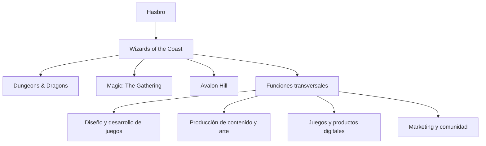
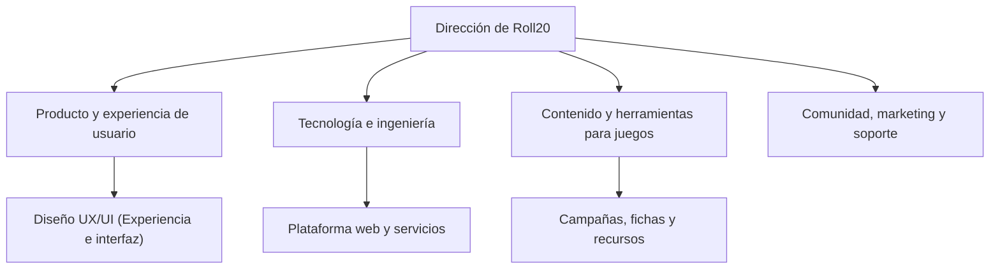
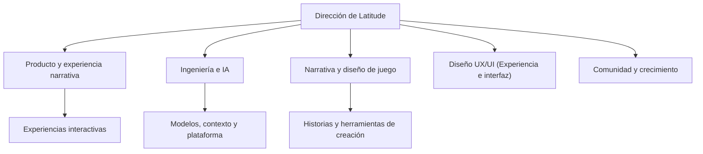
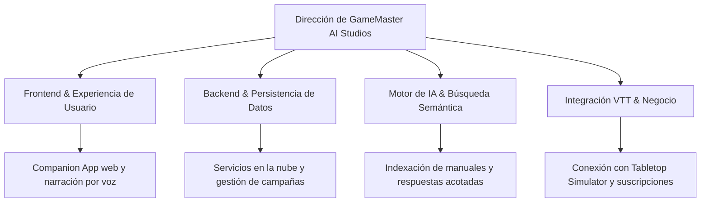

# GameMaster AI — Pitch Inicial & Análisis de Mercado

---

## Portada y Presentación

| Parámetro | Detalle |
| :--- | :--- |
| **Startup Ficticia** | **GameMaster AI Studios S.L.** |
| **Producto Digital** | **GameMaster AI** — SaaS (Software como Servicio) Companion App Web para narración inteligente por voz con IA (Inteligencia Artificial) acotada para juegos de rol de mesa, integrable con Tabletop Simulator |
| **Equipo de Desarrollo** | **Abel Carbonero Mora** **Miguel Ángel Lastra Garcés** **Christian Said Jimenez Mahecha** **Rafael Riego Ruz** |
| **Ciclo Formativo** | 2º DAW (Desarrollo de Aplicaciones Web) — ILERNA (2026/2027) *Módulos: DWS, DWC, DIW, DA, IPE II, IP, PI* |

---

## Índice

- [1. Introducción al Sector y Propuesta de Valor](#1-introducción-al-sector-y-propuesta-de-valor)
- [2. Empresas Analizadas y Organigramas de Referencia](#2-empresas-analizadas-y-organigramas-de-referencia)
  - [2.1. Wizards of the Coast (Gran Empresa)](#21-wizards-of-the-coast-gran-empresa)
  - [2.2. Roll20 (Mediana Empresa)](#22-roll20-mediana-empresa)
  - [2.3. Latitude Inc. (Pequeña Empresa)](#23-latitude-inc-pequeña-empresa)
  - [2.4. Comparativa de Estructuras Organizativas](#24-comparativa-de-estructuras-organizativas)
  - [2.5. Departamentos Clave, Funciones y Contribución al Negocio](#25-departamentos-clave-funciones-y-contribución-al-negocio)
  - [2.6. Comparativa Estratégica con GameMaster AI](#26-comparativa-estratégica-con-gamemaster-ai)
- [3. Organigrama de GameMaster AI](#3-organigrama-de-gamemaster-ai)
- [4. Necesidades y Volumen de Negocio](#4-necesidades-y-volumen-de-negocio)
  - [4.1. Análisis y Dimensión del Mercado](#41-análisis-y-dimensión-del-mercado)
  - [4.2. Necesidades del Cliente y Solución](#42-necesidades-del-cliente-y-solución)
  - [4.3. Modelo de Negocio e Ingresos](#43-modelo-de-negocio-e-ingresos)
  - [4.4. Ejemplos Concretos de Proyectos, Clientes y Precios](#44-ejemplos-concretos-de-proyectos-clientes-y-precios)
  - [4.5. Estructura de Costes y Rentabilidad](#45-estructura-de-costes-y-rentabilidad)
- [5. Tendencias y Oportunidades](#5-tendencias-y-oportunidades)
  - [5.1. Tendencias Clave del Sector](#51-tendencias-clave-del-sector)
  - [5.2. Oportunidades Estratégicas para GameMaster AI](#52-oportunidades-estratégicas-para-gamemaster-ai)
- [6. Conclusiones Iniciales y Justificación del Proyecto](#6-conclusiones-iniciales-y-justificación-del-proyecto)
  - [6.1. Viabilidad de Producto y Mercado](#61-viabilidad-de-producto-y-mercado)
  - [6.2. Ventajas Competitivas frente a los Referentes](#62-ventajas-competitivas-frente-a-los-referentes)
  - [6.3. Capacidad de Ejecución del Equipo](#63-capacidad-de-ejecución-del-equipo)
  - [6.4. Dictamen Final](#64-dictamen-final)
- [Fuentes y Referencias](#fuentes-y-referencias)

---

## 1. Introducción al Sector y Propuesta de Valor

El sector de los juegos de rol de mesa (*Tabletop Role-Playing Games* - TTRPG) y las plataformas de tableros virtuales (*Virtual Tabletops* - VTT) vive una transformación histórica impulsada por la digitalización y el auge de las tecnologías generativas.

- **Mercado Global VTT (Tableros Virtuales) & Digital:** Valoración superior a **3.800 millones de dólares**.
- **Mercado Específico TTRPG (Juegos de Rol de Mesa):** Movimiento estimado en más de **2.300 millones de dólares**, con un CAGR (tasa de crecimiento anual compuesto) superior al **9,6%** anual.
- **Cuello de Botella Crítico:** La escasez de "Game Masters" (GM) o Directores de Juego (DM). Dirigir una campaña exige decenas de horas de lectura de extensos manuales, diseño de escenarios y cálculo de reglas.

> [!NOTE]
> **Misión y Propuesta de Valor:** GameMaster AI es una **SaaS (Software como Servicio) Companion App Web** concebida para actuar como un Narrador virtual por voz acotado por IA (Inteligencia Artificial). Ingiere reglamentos y módulos en PDF (formato de documento portátil), escucha las acciones de los jugadores por micrófono mediante reconocimiento de voz en tiempo real y responde narrando en directo, integrándose de forma transparente con el tablero virtual de **Tabletop Simulator** mediante sincronización automática con los eventos de la mesa de juego.

---

## 2. Empresas Analizadas y Organigramas de Referencia

Las empresas se analizan por su relación estratégica con el producto: una compañía de referencia en propiedad intelectual y manuales de rol, una plataforma VTT (tableros virtuales) consolidada en el navegador y un referente de narrativa interactiva impulsada por IA (Inteligencia Artificial).

> [!NOTE]
> Los organigramas mostrados a continuación son **modelos funcionales elaborados para este proyecto** a modo de referencia orientativa y no corresponden a organigramas oficiales internos.

### 2.1. Wizards of the Coast (Gran Empresa)

Wizards of the Coast es una filial de Hasbro y referente mundial en el desarrollo de juegos de rol, cartas coleccionables y videojuegos. Cuenta con franquicias insignia como *Dungeons & Dragons*, *Magic: The Gathering* y *Avalon Hill*.

- **Tamaño de la Empresa:** Gran empresa multinacional (plantilla estimada de entre 501 y 1.000 empleados; matriz Hasbro con más de 5.000 empleados a nivel global).
- **Servicios Principales:** Edición y comercialización de manuales de rol oficiales, cartas coleccionables, novelas, herramientas digitales oficiales (*D&D Beyond*) y licencias multimedia.
- **Clientes y Público Objetivo:** Consumidor final aficionado al ocio de mesa (B2C), tiendas especializadas de cómics y juegos (B2B), y licenciatarios de videojuegos y cine.

#### Análisis como referencia

- **Fortalezas:** Marcas consolidadas, universos narrativos de amplio recorrido, manuales reglados exhaustivos y comunidades masivas de jugadores activos.
- **Relación con GameMaster AI:** Referente en estructuración de campañas, ambientación y lore. La plataforma web permitirá que los usuarios suban sus manuales en PDF y consulten datos canónicos en tiempo real.
- **Aprendizaje aplicable:** Priorizar la coherencia absoluta entre narrativa y reglas vigentes, permitiendo indexar y localizar información clave de forma inmediata.
- **Diferencia de escala:** GameMaster AI no busca crear ni sustituir una editorial de contenidos, sino actuar como herramienta web complementaria para la dirección de partidas.

#### Organigrama funcional de referencia

### 2.2. Roll20 (Mediana Empresa)

Roll20 es la plataforma web de referencia para partidas de rol y juegos de mesa en remoto. Ofrece un espacio integral accesible desde el navegador con gestión de fichas de personaje, mapas, audio y dados digitales.

- **Tamaño de la Empresa:** Mediana empresa tecnológica (plantilla estimada en el rango de 51 a 200 empleados).
- **Servicios Principales:** Plataforma SaaS de tablero virtual (VTT) en navegador, tienda digital de módulos y campañas oficiales, sistema de suscripciones y herramientas de gestión de partidas a distancia.
- **Clientes y Público Objetivo:** Directores de juego y jugadores de rol en remoto (B2C), clubes de juego en línea y editoriales asociadas que venden contenidos en su marketplace (B2B).

#### Análisis como referencia

- **Fortalezas:** Accesibilidad universal vía navegador web, centralización de herramientas de gestión de mesa y facilidad de coordinación de partidas a distancia.
- **Relación con GameMaster AI:** Constituye la referencia más directa de experiencia de usuario en navegador. GameMaster AI actúa como companion app web optimizada para pantalla de apoyo secundaria, aportando narración por voz y contexto sin interferir con la mesa de juego.
- **Aprendizaje aplicable:** Diseñar una interfaz web ligera, temática y adaptativa que funcione de forma ágil como pantalla de apoyo durante la sesión de juego, facilitando una navegación rápida sin interrumpir el ritmo de la partida en el ordenador.
- **Oportunidad de diferenciación:** Especializarse en la figura del Narrador o DM (Director de Juego) asistido por IA acotada mediante RAG (generación aumentada por recuperación), garantizando respuestas estrictamente fidedignas a los documentos aportados y enlazadas con los eventos de Tabletop Simulator.

#### Organigrama funcional de referencia

### 2.3. Latitude Inc. (Pequeña Empresa)

Latitude representa una compañía ágil especializada en experiencias de narrativa interactiva impulsadas por modelos de lenguaje generativos, destacando por su producto web *AI Dungeon*. Permite a los usuarios sumergirse en aventuras narrativas donde las acciones del jugador modifican dinámicamente la historia.

- **Tamaño de la Empresa:** Pequeña empresa / Startup tecnológica (plantilla estimada reducida de entre 10 y 30 profesionales).
- **Servicios Principales:** Aplicación web y móvil de generación procedimental de historias con IA, suscripciones premium para modelos avanzados de lenguaje y herramientas de creación narrativa comunitaria.
- **Clientes y Público Objetivo:** Aficionados a la ficción interactiva, jugadores de rol en solitario y entusiastas de la inteligencia artificial generativa (B2C).

> [!NOTE]
> **Aclaración sobre AI Game Master:** *AI Game Master - Dungeon RPG* es una app móvil comercial independiente desarrollada por Digital Dynasty Entertainment en tiendas de aplicaciones. Se toma únicamente como referencia externa de interacción por voz en el mercado. En contraposición, **GameMaster AI es una plataforma SaaS (Software como Servicio) 100% Web** concebida para utilizarse desde el navegador en PC como pantalla de apoyo durante partidas virtuales en Tabletop Simulator.

#### Análisis como referencia

- **Fortalezas:** Generación de historias dinámicas no lineales, adaptabilidad a la creatividad de los jugadores y experiencia conversacional fluida.
- **Relación con GameMaster AI:** Permite estudiar dinámicas conversacionales ágiles con IA. GameMaster AI se diferencia al centrarse en partidas regladas, persistencia del estado de la campaña y sincronización con el tablero de Tabletop Simulator.
- **Aprendizaje aplicable:** Mantener continuidad narrativa coherente entre intervenciones sucesivas respetando los límites del escenario.
- **Riesgo que se debe controlar:** La alucinación de contenido. GameMaster AI implementa filtros de seguridad (*Guardrails*) e instrucciones de acotación estrictas que limitan a la IA a responder exclusivamente según los manuales PDF indexados, impidiendo desviaciones a temas ajenos a la partida.

#### Organigrama funcional de referencia

### 2.4. Comparativa de Estructuras Organizativas

El análisis de las empresas de referencia permite identificar tres modelos de estructura empresarial marcadamente diferenciados en el sector:

1. **Gran Corporación Editorial Matricial (Wizards of the Coast / Hasbro):** Presenta una estructura jerárquica compleja con departamentos transversales corporativos (legal, fabricación física, finanzas multinacionales y licencias globales). Sus unidades operan de forma segmentada por franquicias comerciales, con ciclos de lanzamiento anuales y procesos de decisión burocráticos.
2. **Mediana Empresa Tecnológica Funcional (Roll20):** Adopta una estructura departamental centrada en el producto digital y el servicio en la nube. Las áreas de ingeniería, diseño de producto y catálogo de licencias interactúan estrechamente, priorizando la estabilidad del software web y la fidelización comunitaria sobre la creación de contenido editorial físico.
3. **Startup Ágil y Horizontal (Latitude Inc. y GameMaster AI):** Opera con una jerarquía plana y flexible, donde los equipos técnicos combinan diseño de producto, ingeniería de software e investigación de inteligencia artificial. Esta estructura maximiza la velocidad de iteración, permitiendo implementar mejoras y actualizaciones en ciclos de semanas en lugar de años.

### 2.5. Departamentos Clave, Funciones y Contribución al Negocio

| Área Departamental | Funciones Principales | Relevancia y Contribución al Negocio |
| :--- | :--- | :--- |
| **Diseño de Producto, Juego y Narrativa** | Creación de reglas, mecánicas de rol, lore de campaña y guías de interacción narrativa. | **Es el núcleo de la propuesta de valor:** genera el atractivo del juego, fideliza a los usuarios y fundamenta la diferenciación frente a la competencia. |
| **Tecnología, Plataforma e IA** | Desarrollo de la aplicación web, infraestructura de servidores, persistencia de datos y modelos de IA. | **Sustenta la operatividad del servicio:** garantiza la disponibilidad en línea, la escalabilidad técnica y el funcionamiento fluido de la narración en tiempo real. |
| **Comunidad, Marketing y Soporte** | Difusión en comunidades de rol, soporte a usuarios, gestión de comentarios y eventos en línea. | **Impulsa el crecimiento y la retención:** capta nuevos directores de juego, resuelve incidencias y reduce la tasa de cancelación (*churn*) de suscripciones. |
| **Operaciones, Finanzas y Monetización** | Gestión de pasarelas de pago, administración de suscripciones y control de costes de infraestructura. | **Asegura la rentabilidad empresarial:** supervisa que el ingreso medio por usuario supere los costes de computación, garantizando un margen operativo saludable. |

### 2.6. Comparativa Estratégica con GameMaster AI

| Referencia | Formato / Enfoque | Aportación principal | Qué aprende y cómo se diferencia GameMaster AI |
| :--- | :--- | :--- | :--- |
| **Wizards of the Coast** | Gran editorial internacional | Reglas oficiales, ambientación y lore de campañas | GameMaster AI incorpora indexación semántica mediante RAG (generación aumentada por recuperación) de manuales PDF para mantener fidelidad reglamentaria estricta |
| **Roll20** | Plataforma SaaS (Software como Servicio) Web de VTT | Herramientas web para organizar partidas en navegador | GameMaster AI adopta una arquitectura web moderna, ágil y pensada como pantalla de apoyo secundaria durante la partida |
| **Latitude (*AI Dungeon*)** | Plataforma de narrativa con IA | Historias dinámicas y generación de texto interactivo | GameMaster AI aplica filtros (*Guardrails*) estrictos para evitar alucinaciones y ceñirse al escenario cargado |
| ***AI Game Master* (Externa)** | App móvil comercial nativa | Interacción por voz y ambientación sonora en tiendas móviles | Referencia de voz; GameMaster AI se diferencia como solución **SaaS Web** sincronizada automáticamente con los eventos del tablero de **Tabletop Simulator** |

> [!NOTE]
> **Conclusión Estratégica:** GameMaster AI integra las fortalezas de cada referencia: adopta el rigor reglamentario de las grandes editoriales de rol, la accesibilidad de una solución web moderna en la nube tipo SaaS (Software como Servicio), la inmersión por voz y la interacción de modelos de lenguaje LLM (modelos de lenguaje grande) acotados. Su gran elemento diferenciador radica en la ingesta de manuales de la propia mesa y la comunicación bidireccional en tiempo real con Tabletop Simulator.

---

## 3. Organigrama de GameMaster AI

El organigrama funcional de **GameMaster AI Studios** se estructura a partir de las áreas funcionales de la empresa y los módulos clave de la plataforma web, siguiendo el mismo modelo organizativo de las compañías de referencia. 

Esta estructura distribuye las funciones del producto de forma colaborativa entre los integrantes del **EQUIPO MAC**, asignando a cada miembro la responsabilidad técnica de un área clave para asegurar un desarrollo coordinado y equilibrado:

---

## 4. Necesidades y Volumen de Negocio

### 4.1. Análisis y Dimensión del Mercado

El proyecto se posiciona en la intersección entre los juegos de rol de mesa (TTRPG, *Tabletop Role-Playing Games*), las plataformas de tableros virtuales (VTT, *Virtual Tabletops*) y las aplicaciones SaaS (Software como Servicio) impulsadas por inteligencia artificial.

- **Valoración Actual del Mercado TTRPG:** Estimado en **2.310 millones de dólares en 2025** a nivel mundial.
- **Proyección de Crecimiento:** Se proyecta alcanzar **5.230 millones de dólares en 2034**, con un CAGR (tasa de crecimiento anual compuesto) del **9,61%** anual.
- **Posicionamiento Estratégico:** GameMaster AI no compite con las grandes editoriales ni busca sustituir los tableros virtuales; actúa como una **companion app web complementaria** que reduce drásticamente las horas de preparación y asiste en la narración en directo.

### 4.2. Necesidades del Cliente y Solución

La principal barrera del sector es la **sobrecarga del Director de Juego (DM o GM)**, quien debe memorizar cientos de páginas de reglas, coordinar la trama e interpretar personajes simultáneamente.

| Segmento de Usuario | Necesidad Principal | Solución de GameMaster AI |
| :--- | :--- | :--- |
| **DMs (Directores de Juego) Experimentados** | Reducir el tiempo de preparación y agilizar consultas de reglas complejas. | Búsqueda semántica inmediata sobre manuales PDF mediante RAG (generación aumentada por recuperación) y narración asistida. |
| **DMs Principiantes** | Falta de soltura para improvisar narraciones y resolver dudas de juego en directo. | Soporte narrativo por voz en tiempo real con apego estricto a las reglas del manual. |
| **Jugadores de Rol** | Evitar parones prolongados que rompen la inmersión de la partida. | Diálogo continuo por voz con captura por micrófono sin abandonar la partida. |
| **Grupos VTT (Tableros Virtuales) en Remoto** | Conectar los eventos del tablero con la historia de forma automatizada. | Sincronización transparente con Tabletop Simulator mediante eventos automatizados del tablero. |
| **Clubes y Tiendas** | Dinamizar múltiples mesas simultáneas y facilitar partidas introductorias. | Herramienta reutilizable y configurable para cualquier sistema de campaña. |

### 4.3. Modelo de Negocio e Ingresos

GameMaster AI opera bajo un modelo **SaaS (Software como Servicio) Freemium** con pasarela de pago segura:

1. **Plan Gratuito (Free Tier):** Acceso a IA base, límite de consultas por sesión y carga de manuales PDF de tamaño estándar.
2. **Suscripción Pro / Individual:** Orientada a directores habituales con un ingreso medio proyectado de **8 €/mes**, desbloqueando modelos de IA generativa avanzados (LLM - modelos de lenguaje grande), respuestas más elaboradas, mayor memoria contextual y carga de manuales de gran tamaño.
3. **Planes para Grupos y Clubes:** Cuotas anuales o mensuales reducidas por volumen para asociaciones y tiendas especializadas.
4. **Servicios de Configuración:** Preparación personalizada de campañas complejas o integración de módulos a medida.

### 4.4. Ejemplos Concretos de Proyectos, Clientes y Precios

Para fundamentar la estimación del volumen de negocio, se proyectan cuatro escenarios comerciales representativos con precios definidos:

| Tipo de Cliente / Proyecto | Necesidad Específica | Solución y Modalidad de Pago | Facturación Estimada |
| :--- | :--- | :--- | :--- |
| **Grupo de Rol Semanal** (Mesa habitual de amigos) | Narración inmersiva continuada y consulta rápida de reglas sin interrumpir la partida. | Suscripción Individual Pro (8 €/mes) contratada por el Director de Juego. | **96 €/año** por grupo activo |
| **Club o Asociación de Rol** (Comunidad con 5 mesas activas) | Dinamizar múltiples partidas simultáneas y rotar manuales de diferentes ambientaciones. | Plan Comunitario / Grupal con soporte multisesión (35 €/mes). | **420 €/año** por asociación |
| **Tienda Especializada de Juegos** (Espacio de demostración y venta) | Atraer nuevos clientes con partidas introductorias guiadas por narración asistida. | Licencia Comercial para partidas en tienda (50 €/mes o 250 €/evento patrocinado). | **600 €/año** (o pago puntual por evento) |
| **Cliente Empresarial / Creador** (Campaña temática personalizada) | Digitalización, configuración RAG e indexación a medida de un módulo de autor. | Servicio profesional de configuración de campaña bajo presupuesto cerrado. | **150 € – 300 €** (pago único por proyecto) |

### 4.5. Estructura de Costes y Rentabilidad

Para garantizar la sostenibilidad económica, se monitorean los costes operativos directos frente al LTV (valor de vida del cliente):

| Área de Coste | Concepto | Estrategia de Control y Rentabilidad |
| :--- | :--- | :--- |
| **Consumo de Servicios de IA** | Tokens de procesamiento de modelos LLM (modelos de lenguaje grande) y síntesis/transcripción de voz. | Filtros (*Guardrails*) estrictos, caché semántica y límites de consumo por plan. |
| **Infraestructura Cloud** | Servidores en la nube, base de datos relacional y almacenamiento seguro de manuales. | Arquitectura web escalable bajo demanda en la nube. |
| **Indexación y Búsqueda Semántica** | Procesamiento semántico mediante RAG (generación aumentada por recuperación) de manuales de campañas en PDF. | Indexación optimizada por documento con persistencia eficiente. |
| **Adquisición (CAC - Coste de Captación de Clientes)** | Promoción en comunidades especializadas de rol y VTT (tableros virtuales). | Crecimiento orgánico apoyado en la integración con Tabletop Simulator y el plan gratuito. |

> [!NOTE]
> **Criterio de Viabilidad:** La rentabilidad se alcanza asegurando que el coste variable medio de consumo de computación de IA por usuario de pago se mantenga por debajo del **25-30% de la cuota mensual (8 €)**, destinando el margen restante a costes fijos e inversión en producto.

---

## 5. Tendencias y Oportunidades

### 5.1. Tendencias Clave del Sector

1. **Digitalización Definitiva del Rol y Auge VTT (Tableros Virtuales):** Plataformas como Tabletop Simulator, Roll20 y Foundry VTT han dejado de ser alternativas puntuales para consolidarse como el estándar del juego a distancia.
2. **Adopción de IA Generativa en Ocio Interactivo:** Los usuarios demandan mundos reactivos y conversacionales que respondan a la creatividad individual sin encorsetarse en árboles de diálogo rígidos.
3. **Prioridad a la Voz y Experiencias Manos Libres:** Durante una sesión en ordenador, los jugadores prefieren interactuar hablando por micrófono en lugar de escribir comandos en un teclado.
4. **Democratización del Acceso:** El auge de la cultura popular (series, podcasts de rol) atrae a millones de novatos que requieren herramientas intuitivas que eliminen la barrera de entrada de manuales de 300+ páginas.

### 5.2. Oportunidades Estratégicas para GameMaster AI

- **Pioneros en Asistencia por Voz Multimodal:** No existe en el mercado actual ninguna companion app web que unifique voz en tiempo real, RAG (generación aumentada por recuperación) estricto sobre manuales PDF y conexión directa con el tablero virtual de Tabletop Simulator.
- **Apalancamiento en un Ecosistema Ya Consolidado:** Al sincronizarse directamente con los eventos de Tabletop Simulator, el proyecto no necesita desarrollar un costoso motor gráfico 3D propio, beneficiándose del extenso catálogo de mods existente.
- **Alta Retención de Grupos de Juego:** Las campañas de rol se juegan con frecuencia semanal o quincenal durante meses o años, lo que genera un *churn rate* (tasa de cancelación) muy reducido y una alta fidelización del cliente.
- **Escalabilidad para Futuras Actualizaciones:** La arquitectura desacoplada y el sistema RAG sientan las bases técnicas para que la plataforma pueda evolucionar en versiones posteriores, permitiendo incorporar progresivamente soporte para nuevos juegos, manuales y sistemas de rol según la acogida del proyecto.

> [!NOTE]
> **Conclusión:** La conjunción entre un mercado en expansión (CAGR del 9,61%) y la falta de soluciones de narración por voz acotadas convierte a GameMaster AI en una oportunidad única para liderar el segmento de asistencia inteligente para juegos de rol virtuales.

---

## 6. Conclusiones Iniciales y Justificación del Proyecto

### 6.1. Viabilidad de Producto y Mercado

- **Viabilidad Funcional y de Adopción:** GameMaster AI aborda el principal cuello de botella del sector: la sobrecarga de preparación del Director de Juego (DM). Al operar como una aplicación web complementaria para pantalla de apoyo, no pretende sustituir a los tableros virtuales existentes ni obligar a los grupos a cambiar de plataforma, sino enriquecer la sesión con narración inmersiva y resolución inmediata de reglas.
- **Viabilidad Económica:** El modelo SaaS (Software como Servicio) Freemium con cuota Pro accesible (~8 €/mes) permite una monetización escalable con un margen bruto estimado superior al **70%**. La optimización del consumo de IA mediante documentos indexados y límites por sesión asegura costes de servicio predecibles y contenidos.

### 6.2. Ventajas Competitivas frente a los Referentes

- **Frente a Grandes Editoriales (Wizards of the Coast):** Las grandes corporaciones priorizan ecosistemas cerrados vinculados a sus propias licencias. GameMaster AI aporta **neutralidad de sistema y agilidad**, permitiendo cargar cualquier manual en PDF y adaptarse al reglamento preferido por cada mesa.
- **Frente a Plataformas VTT (Tableros Virtuales) Consolidadas (Roll20):** Los tableros virtuales tradicionales resuelven la digitalización de fichas y dados, pero no reducen el esfuerzo narrativo ni ofrecen interacción conversacional por voz. GameMaster AI actúa como un **asistente activo en directo**, ahorrando horas de preparación a los directores de juego.
- **Frente a Startups de Narrativa con IA (Latitude Inc.):** Los generadores de historias abiertos tienden a inventar datos o ignorar las normas del juego. GameMaster AI se diferencia por su **acotación estricta al manual de campaña**, garantizando fidelidad reglamentaria sin alucinaciones.

### 6.3. Capacidad de Ejecución del Equipo

El equipo fundacional (**EQUIPO MAC**) reúne las competencias necesarias para cubrir el ciclo íntegro del producto:
- **Gestión Ágil y Calidad:** Coordinación bajo metodología Scrumban para asegurar entregas continuas, control del backlog y revisiones rigurosas de desarrollo.
- **Especialización Funcional:** Distribución equilibrada entre experiencia web de usuario, lógica de negocio y gestión de campañas, y procesamiento avanzado de inteligencia artificial y voz.

### 6.4. Dictamen Final

> [!NOTE]
> **Conclusión Estratégica:** GameMaster AI cuenta con una oportunidad clara y fundamentada en el mercado. Su fortaleza competitiva no consiste en rivalizar con los presupuestos millonarios de las editoriales ni en rehacer un motor gráfico virtual, sino en **liderar el nicho desatendido del asistente narrativo por voz con fidelidad reglamentaria estricta**. Respaldado por un mercado en constante expansión (+9,6% anual), una propuesta diferenciadora y costes operativos contenidos, el proyecto se consolida como una iniciativa **viable, sostenible y con alto potencial de crecimiento**.

---

### Fuentes y Referencias

- **Estudios de Mercado y Perspectivas del Sector:**
  - [Fortune Business Insights — Tabletop Role-Playing Game Market](https://www.fortunebusinessinsights.com/tabletop-role-playing-game-market-119102): Datos de valoración global y proyecciones de crecimiento del sector TTRPG (2025–2034).
  - [Polaris Market Research — Virtual Tabletop Market Report](https://www.polarismarketresearch.com/industry-analysis/virtual-tabletop-market): Crecimiento y métricas de adopción de plataformas de juego de mesa digital (VTT).
- **Empresas y Plataformas Analizadas:**
  - [Wizards of the Coast (Hasbro)](https://company.wizards.com/es/who-we-are): Perfil corporativo de la editorial de referencia en juegos de rol y licencias oficiales (*Dungeons & Dragons*).
  - [Roll20](https://roll20.net/) y [Centro de Ayuda de Roll20](https://help.roll20.net/): Plataforma web líder de tableros virtuales y gestión de partidas en remoto.
  - [Latitude Inc.](https://latitude.io/press): Información corporativa y desarrollo de aventuras narrativas impulsadas por IA (*AI Dungeon*).
  - [AI Game Master (Digital Dynasty Entertainment)](https://www.aigamemaster.app/about): Aplicación de referencia en ambientación sonora y narración conversacional con IA.
- **Ecosistema de Tableros Virtuales:**
  - [Tabletop Simulator — Berserk Games (Steam Store)](https://store.steampowered.com/app/286160/TabletopSimulator/): Plataforma VTT 3D de referencia y entorno de scripting para partidas físicas simuladas.