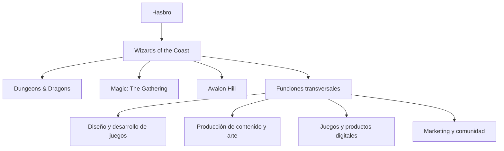
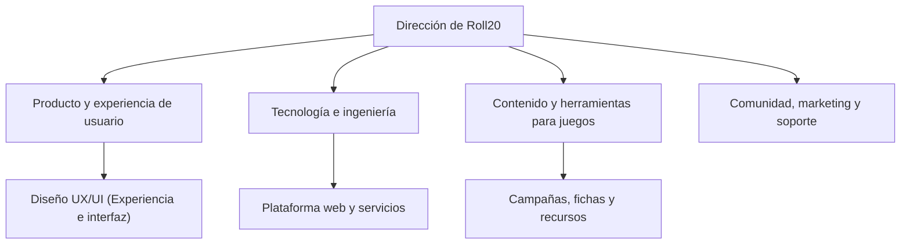
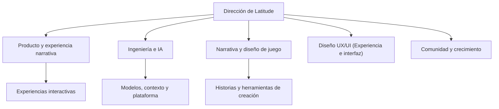
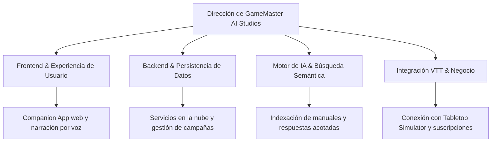

# GameMaster AI — Pitch Inicial & Análisis de Mercado

---

## Portada y Presentación

| Parámetro | Detalle |
| :--- | :--- |
| **Startup Ficticia** | **GameMaster AI Studios S.L.** |
| **Producto Digital** | **GameMaster AI** — SaaS (Software como Servicio) Companion App Web para narración inteligente por voz con IA (Inteligencia Artificial) acotada para juegos de rol de mesa, integrable con Tabletop Simulator |
| **Equipo de Desarrollo** | **Abel Carbonero Mora** **Miguel Ángel Lastra Garcés** **Christian Said Jimenez Mahecha** **Rafael Riego Ruz** |
| **Ciclo Formativo** | 2º DAW (Desarrollo de Aplicaciones Web) — ILERNA (2026/2027) *Módulos: DWS, DWC, DIW, DA, IPE II, IP, PI* |

---

## Índice

- [1. Introducción al Sector y Propuesta de Valor](#1-introducción-al-sector-y-propuesta-de-valor)
- [2. Empresas Analizadas y Organigramas de Referencia](#2-empresas-analizadas-y-organigramas-de-referencia)
  - [2.1. Wizards of the Coast (Gran Empresa)](#21-wizards-of-the-coast-gran-empresa)
  - [2.2. Roll20 (Mediana Empresa)](#22-roll20-mediana-empresa)
  - [2.3. Latitude Inc. (Pequeña Empresa)](#23-latitude-inc-pequeña-empresa)
  - [2.4. Comparativa de Estructuras Organizativas](#24-comparativa-de-estructuras-organizativas)
  - [2.5. Comparativa Estratégica con GameMaster AI](#25-comparativa-estratégica-con-gamemaster-ai)
- [3. Organigrama de GameMaster AI](#3-organigrama-de-gamemaster-ai)
- [4. Descripción de Departamentos y Funciones](#4-descripción-de-departamentos-y-funciones)
  - [4.1. Caracterización de los Departamentos Principales y su Relevancia](#41-caracterización-de-los-departamentos-principales-y-su-relevancia)
  - [4.2. Matriz Detallada de Funciones y Contribución al Negocio](#42-matriz-detallada-de-funciones-y-contribución-al-negocio)
  - [4.3. Comparativa Departamental según el Modelo de Empresa](#43-comparativa-departamental-según-el-modelo-de-empresa)
- [5. Necesidades y Volumen de Negocio](#5-necesidades-y-volumen-de-negocio)
  - [5.1. Análisis y Dimensión del Mercado](#51-análisis-y-dimensión-del-mercado)
  - [5.2. Necesidades del Cliente y Solución](#52-necesidades-del-cliente-y-solución)
  - [5.3. Modelo de Negocio e Ingresos](#53-modelo-de-negocio-e-ingresos)
  - [5.4. Ejemplos Concretos de Clientes y Precios](#54-ejemplos-concretos-de-clientes-y-precios)
  - [5.5. Estructura de Costes y Rentabilidad](#55-estructura-de-costes-y-rentabilidad)
- [6. Tendencias y Oportunidades](#6-tendencias-y-oportunidades)
  - [6.1. Tendencias Clave del Sector](#61-tendencias-clave-del-sector)
  - [6.2. Oportunidades para GameMaster AI](#62-oportunidades-para-gamemaster-ai)
- [7. Conclusiones Iniciales y Justificación del Proyecto](#7-conclusiones-iniciales-y-justificación-del-proyecto)
  - [7.1. Viabilidad de Producto y Mercado](#71-viabilidad-de-producto-y-mercado)
  - [7.2. Ventajas Frente a Otras Opciones](#72-ventajas-frente-a-otras-opciones)
  - [7.3. Capacidad del Equipo para Desarrollarlo](#73-capacidad-del-equipo-para-desarrollarlo)
  - [7.4. Dictamen Final](#74-dictamen-final)
- [Fuentes y Referencias](#fuentes-y-referencias)

---

## 1. Introducción al Sector y Propuesta de Valor

Los juegos de rol de mesa (TTRPG, *Tabletop Role-Playing Games*) y las plataformas de tableros virtuales (VTT, *Virtual Tabletops*) están viviendo un gran auge. Cada vez más aficionados juegan por internet a través del ordenador y buscan herramientas digitales que hagan sus partidas más ágiles e inmersivas.

- **Mercado Global de Tableros Virtuales (VTT) y Ocio Digital:** Supera los **3.800 millones de dólares** a nivel mundial.
- **Mercado Específico de Juegos de Rol de Mesa (TTRPG):** Se estima en más de **2.300 millones de dólares**, con un crecimiento anual previsto (CAGR, tasa de crecimiento anual compuesto) del **9,6%**.
- **El problema principal del sector:** La falta de Directores de Juego (DM o GM, *Game Master*). Dirigir una campaña exige dedicar muchas horas previas a leer manuales extensos, preparar la trama y consultar reglas complejas, lo que hace que muchos grupos no jueguen por no tener a nadie dispuesto a dirigir.

> [!NOTE]
> **Nuestra Propuesta como Proyecto:** GameMaster AI es una **aplicación web de apoyo (companion app web) tipo SaaS (Software como Servicio)** pensada para actuar como un Narrador virtual por voz asistido por IA (Inteligencia Artificial). La aplicación lee manuales en PDF (formato de documento portátil), escucha lo que dicen los jugadores por el micrófono en tiempo real y responde narrando la historia en directo, conectándose de forma automática con el tablero virtual de **Tabletop Simulator** para reaccionar a las tiradas de dados y a lo que ocurre en la mesa.

---

## 2. Empresas Analizadas y Organigramas de Referencia

Para orientar el desarrollo de nuestro proyecto y definir cómo estructurar nuestra startup ficticia, hemos analizado tres empresas reales de diferentes tamaños en el sector del ocio interactivo: una gran editorial clásica de manuales de rol, una mediana empresa tecnológica con plataforma web propia y una pequeña empresa pionera en narrativa interactiva con IA.

> [!NOTE]
> **Aclaración Metodológica:** Al ser un proyecto final de ciclo formativo con una empresa ficticia, los organigramas mostrados a continuación son **modelos funcionales elaborados por el equipo** a partir de datos públicos para entender cómo se organizan estas empresas y qué podemos aprender de cada una.

### 2.1. Wizards of the Coast (Gran Empresa)

Wizards of the Coast es una filial de Hasbro y la editorial líder mundial en juegos de rol y cartas coleccionables, conocida por franquicias tan populares como *Dungeons & Dragons* y *Magic: The Gathering*.

- **Tamaño de la Empresa:** Gran empresa multinacional (plantilla estimada de entre 501 y 1.000 empleados, respaldada por Hasbro con más de 5.000 empleados en todo el mundo).
- **Servicios Principales:** Publicación y venta de manuales de rol físicos y digitales, cartas coleccionables, novelas, herramientas web oficiales (*D&D Beyond*) y licencias para cine y videojuegos.
- **Clientes y Público:** Jugadores particulares (B2C), tiendas especializadas de juegos y cómics (B2B), y grandes productoras audiovisuales.

#### Análisis como referencia para nuestro proyecto

- **Puntos Fuertes:** Marcas muy reconocidas, universos de fantasía con décadas de historia, manuales de reglas muy completos y millones de jugadores activos.
- **Relación con GameMaster AI:** Nos sirve como modelo de cómo organizar una campaña, estructurar las reglas y crear ambientación. Nuestra plataforma web permitirá a los usuarios subir sus propios manuales en PDF para consultarlos al instante durante la partida.
- **Qué aprendemos de ella:** La importancia de respetar las reglas oficiales al pie de la letra, permitiendo que la IA localice e interprete los datos del manual con total precisión.
- **Diferencia de escala:** Como proyecto final, no pretendemos ser una editorial de contenidos ni crear libros de rol, sino una herramienta web práctica que ayude a jugarlos mejor.

#### Organigrama funcional de referencia

### 2.2. Roll20 (Mediana Empresa)

Roll20 es la plataforma web más conocida para jugar a juegos de rol a distancia desde el navegador, ofreciendo tableros virtuales con dados digitales, mapas interactivos y fichas de personajes.

- **Tamaño de la Empresa:** Mediana empresa tecnológica (con una plantilla estimada de 51 a 200 empleados).
- **Servicios Principales:** Plataforma SaaS de tablero virtual (VTT) en el navegador, tienda digital de manuales y aventuras oficiales, y suscripciones de pago para funciones avanzadas.
- **Clientes y Público:** Jugadores y directores de juego en remoto (B2C), asociaciones de rol y editoriales que venden sus libros en su tienda digital (B2B).

#### Análisis como referencia para nuestro proyecto

- **Puntos Fuertes:** Funciona directamente desde el navegador web sin instalar nada, facilita coordinar partidas con amigos a distancia y centraliza todas las herramientas de la mesa.
- **Relación con GameMaster AI:** Es nuestro referente más claro de cómo debe ser una aplicación web de rol. GameMaster AI está pensada como una pantalla de apoyo secundaria que aporta narración por voz y ayuda rápida con las reglas sin estorbar la partida.
- **Qué aprendemos de ella:** Diseñar una interfaz web limpia, rápida y fácil de consultar, para que el director de juego pueda ver los datos que necesita sin perder el ritmo de la sesión.
- **En qué nos diferenciamos:** Roll20 se centra en el tablero (mapas y fichas), mientras que GameMaster AI se enfoca en resolver la falta de narrador mediante voz e IA acotada con RAG (generación aumentada por recuperación), respondiendo siempre según los manuales PDF aportados y enlazada con Tabletop Simulator.

#### Organigrama funcional de referencia

### 2.3. Latitude Inc. (Pequeña Empresa)

Latitude es una pequeña empresa tecnológica conocida por crear *AI Dungeon*, una plataforma web donde los jugadores participan en aventuras de texto donde la historia se va generando sobre la marcha con inteligencia artificial.

- **Tamaño de la Empresa:** Pequeña empresa / Startup tecnológica (equipo reducido de entre 10 y 30 trabajadores).
- **Servicios Principales:** Aplicación web y móvil de historias interactivas con IA, suscripciones para acceder a modelos de lenguaje más potentes y herramientas de creación comunitaria.
- **Clientes y Público:** Aficionados a la ficción interactiva, jugadores de rol en solitario y entusiastas de la inteligencia artificial (B2C).

> [!NOTE]
> **Aclaración sobre AI Game Master:** *AI Game Master - Dungeon RPG* es una app móvil comercial desarrollada por Digital Dynasty Entertainment. La tomamos solo como referencia externa de cómo se usa la voz en el mercado móvil. Por el contrario, **GameMaster AI es una aplicación SaaS (Software como Servicio) 100% Web** pensada para usarse en el ordenador como pantalla de apoyo durante partidas en Tabletop Simulator.

#### Análisis como referencia para nuestro proyecto

- **Puntos Fuertes:** Genera historias improvisadas sobre la marcha, se adapta muy bien a las ideas de los jugadores y ofrece una conversación fluida.
- **Relación con GameMaster AI:** Nos sirve para estudiar cómo interactúan los usuarios con una IA que narra historias. GameMaster AI da un paso más allá al centrarse en partidas de rol con reglas fijas y sincronización con el tablero de Tabletop Simulator.
- **Qué aprendemos de ella:** La importancia de mantener la coherencia narrativa entre una intervención y otra sin salirse de la ambientación.
- **Riesgo que debemos controlar:** Evitar que la IA se invente cosas ("alucinaciones"). Para solucionarlo, en GameMaster AI usamos filtros de control (*Guardrails*) e instrucciones estrictas para que la IA responda únicamente con la información de los manuales PDF que suba el usuario.

#### Organigrama funcional de referencia

### 2.4. Comparativa de Estructuras Organizativas

Comparar estas tres empresas nos permite entender tres formas muy distintas de trabajar en el sector:

1. **Gran Corporación (Wizards of the Coast / Hasbro):** Funciona con una estructura jerárquica compleja, con departamentos separados para asuntos legales, imprenta física, videojuegos y licencias. Sus decisiones son lentas y los nuevos lanzamientos se planifican de año en año.
2. **Mediana Empresa Tecnológica (Roll20):** Tiene una organización centrada en el software web y la nube. Sus equipos de programación, diseño y atención al cliente trabajan muy cerca, priorizando que la web no falle y que los usuarios estén satisfechos.
3. **Startup Ágil (Latitude Inc. y nuestro proyecto GameMaster AI):** Opera con un equipo pequeño y horizontal, donde todos los miembros colaboran en el diseño, la programación y las pruebas. Esto permite probar cambios, corregir errores y actualizar el producto en cuestión de semanas.

### 2.5. Comparativa Estratégica con GameMaster AI

| Referencia | Formato / Enfoque | Lo mejor de su modelo | Qué aprendemos y cómo nos diferenciamos en GameMaster AI |
| :--- | :--- | :--- | :--- |
| **Wizards of the Coast** | Gran editorial internacional | Reglas sólidas, ambientación y mundos de rol detallados | Usamos búsqueda semántica RAG (generación aumentada por recuperación) para que la IA respete al pie de la letra cualquier manual PDF que suba el usuario |
| **Roll20** | Plataforma SaaS (Software como Servicio) Web de VTT | Herramientas web cómodas para jugar desde el navegador | Diseñamos una aplicación web ágil y ligera, pensada como pantalla de apoyo durante la sesión de juego |
| **Latitude (*AI Dungeon*)** | Plataforma de narrativa con IA | Respuestas dinámicas y capacidad de improvisación | Añadimos filtros (*Guardrails*) para que la IA no invente datos y se ciña exclusivamente a la aventura cargada |
| ***AI Game Master* (Externa)** | App móvil comercial nativa | Uso de voz y ambientación sonora en teléfonos móviles | Referencia de voz; GameMaster AI es una solución **SaaS Web** para ordenador sincronizada automáticamente con **Tabletop Simulator** |

> [!NOTE]
> **Conclusión del Análisis:** GameMaster AI reúne lo mejor de cada una: la precisión reglamentaria de las grandes editoriales, la comodidad de una web en la nube, la fluidez de hablar por micrófono y la inteligencia de los modelos de lenguaje LLM (modelos de lenguaje grande). Nuestra gran ventaja diferencial es permitir que cada grupo cargue sus propios manuales y conectar la narración en directo con Tabletop Simulator.

---

## 3. Organigrama de GameMaster AI

El organigrama funcional de **GameMaster AI Studios** muestra cómo organizamos el desarrollo de nuestra startup ficticia a partir de las áreas clave de la aplicación web. 

Al ser un equipo de cuatro alumnos en un proyecto final formativo (**EQUIPO MAC**), trabajamos de forma colaborativa y horizontal, donde cada miembro asume la responsabilidad técnica de un área para asegurar que el desarrollo avance de forma coordinada:

---

## 4. Descripción de Departamentos y Funciones

Para organizar el desarrollo de nuestra startup ficticia (**GameMaster AI Studios S.L.**), distribuimos el trabajo en cuatro áreas o departamentos principales. Aunque somos un equipo de cuatro alumnos en un proyecto de ciclo formativo, simular esta estructura empresarial nos permite entender cómo se gestiona un producto digital real, qué responsabilidades asume cada área y cómo contribuyen conjuntamente a que la plataforma sea útil para los jugadores y viable como negocio.

### 4.1. Caracterización de los Departamentos Principales y su Relevancia

Las cuatro áreas de la empresa se reparten las tareas creativas, técnicas, de atención al usuario y de gestión económica:

1. **Departamento de Producto, Juego y Narrativa:**
   - **Qué hace (Caracterización):** Se encarga de diseñar la experiencia de juego y cómo interactúa el usuario con la aplicación. Define el tono y personalidad del Narrador virtual, organiza las aventuras y fichas de ejemplo, comprueba que las reglas de rol se apliquen bien y cuida que la pantalla de apoyo web sea cómoda y fácil de usar durante una partida en directo.
   - **Por qué es importante (Relevancia):** Es el corazón de lo que ofrecemos. Si las historias fueran aburridas o el asistente se inventara reglas que contradicen el manual, los directores de juego no usarían la herramienta.

2. **Departamento de Tecnología, Plataforma e Inteligencia Artificial:**
   - **Qué hace (Caracterización):** Es el motor técnico del proyecto. Desarrolla y mantiene la aplicación web interactiva SaaS (Software como Servicio), gestiona los servidores en la nube, programa la lectura de manuales en PDF (formato de documento portátil) mediante RAG (generación aumentada por recuperación), conecta el micrófono para escuchar a los jugadores por voz y sincroniza las tiradas y eventos con Tabletop Simulator.
   - **Por qué es importante (Relevancia):** Hace posible que el producto funcione en la práctica. Si la web se cae a mitad de una partida o tarda demasiado en responder por voz, la inmersión del juego se rompe por completo.

3. **Departamento de Comunidad, Marketing y Soporte:**
   - **Qué hace (Caracterización):** Mantiene el contacto directo con los jugadores y directores de juego. Da a conocer la aplicación en foros, servidores de rol y redes sociales, ayuda a los usuarios cuando tienen dudas o problemas para configurar sus partidas, y recoge sus sugerencias para seguir mejorando la herramienta.
   - **Por qué es importante (Relevancia):** Ayuda a que el proyecto crezca de forma natural mediante el boca a boca entre aficionados, reduciendo el gasto necesario en publicidad y consiguiendo que los usuarios se queden contentos a largo plazo.

4. **Departamento de Operaciones, Finanzas y Monetización:**
   - **Qué hace (Caracterización):** Administra la parte práctica y económica de la startup ficticia. Configura el cobro seguro con tarjeta, gestiona las cuentas de los usuarios (tanto del plan gratuito como del de pago), controla los costes de los servidores y de las consultas a los modelos de lenguaje LLM (modelos de lenguaje grande), y analiza si los ingresos cubren los gastos.
   - **Por qué es importante (Relevancia):** Asegura que el proyecto sea económicamente sostenible. Vigila que lo que cuesta cada consulta de IA por partida sea mucho menor que lo que paga el usuario por su suscripción, garantizando que la plataforma no genere pérdidas.

### 4.2. Matriz Detallada de Funciones y Contribución al Negocio

En la siguiente tabla se resumen las tareas clave de cada área y la forma concreta en la que ayudan a generar ingresos y mantener la empresa en marcha:

| Departamento | Funciones Principales | Cómo Ayuda al Negocio y a Generar Ingresos |
| :--- | :--- | :--- |
| **Producto, Juego y Narrativa** | • Diseñar cómo habla e improvisa el Narrador virtual. • Preparar plantillas de aventuras, mapas y fichas de rol. • Comprobar que las respuestas respeten las reglas oficiales. • Probar partidas reales para mejorar la jugabilidad. | **Convence y fideliza al usuario:** Crea una experiencia divertida y bien adaptada al rol que anima a los usuarios de la versión gratuita a pasar a la suscripción de pago (Pro). |
| **Tecnología, Plataforma e IA** | • Programar y mantener la aplicación web y los servidores. • Configurar el reconocimiento de voz para hablar por micrófono. • Desarrollar el sistema RAG (generación aumentada por recuperación) para leer manuales PDF. • Conectar la web con los eventos de Tabletop Simulator. • Asegurar respuestas rápidas y proteger los datos de usuario. | **Garantiza un servicio estable y barato de mantener:** Hace que la web esté disponible 24/7 y optimiza las llamadas a la IA para que cada partida cueste pocos céntimos en servidores. |
| **Comunidad, Marketing y Soporte** | • Compartir avances y demostraciones en canales de rol. • Ayudar a los usuarios con dudas técnicas o de configuración. • Organizar partidas abiertas de prueba con la comunidad. • Recopilar ideas de los jugadores para nuevas funciones. | **Consigue nuevos usuarios sin gastar en anuncios:** El boca a boca entre jugadores atrae nuevos directores de juego y una buena atención evita que cancelen su suscripción. |
| **Operaciones, Finanzas y Monetización** | • Configurar la pasarela de pagos y cobro de suscripciones. • Establecer los precios (plan individual a 8 €/mes y clubes). • Controlar que el gasto de IA no supere el 30% de la cuota. • Contactar con tiendas o clubes interesados en licencias de grupo. | **Asegura la rentabilidad del proyecto:** Mantiene los costes variables controlados para lograr un margen amplio que permita pagar los servidores y seguir mejorando el producto. |

### 4.3. Comparativa Departamental según el Modelo de Empresa

La forma de organizar estos departamentos cambia mucho según el tamaño de cada empresa:

- **Gran Empresa (Wizards of the Coast / Hasbro):** Cuenta con cientos de empleados y departamentos muy separados y especializados (un departamento solo para contratos legales de licencias, otro para fabricación e imprenta física, etc.). Tomar decisiones o lanzar un producto nuevo requiere muchos meses de trámites internos.
- **Mediana Empresa (Roll20):** Es una compañía enfocada a su plataforma web. Sus equipos principales se centran en programar el software en la nube, dar soporte continuo a los usuarios y negociar acuerdos con editoriales para vender libros de rol digitales en su tienda.
- **Startup Ficticia / Proyecto Ágil (GameMaster AI Studios):** Al tratarse de un proyecto final de ciclo formativo, trabajamos con una estructura plana y cercana. En lugar de departamentos aislados, los integrantes del equipo colaboramos directamente en el día a día repartiéndonos las tareas técnicas y de gestión, lo que nos permite probar ideas, corregir fallos y añadir mejoras en cuestión de días.

---

## 5. Necesidades y Volumen de Negocio

### 5.1. Análisis y Dimensión del Mercado

Nuestro proyecto se sitúa en la unión de tres ámbitos del ocio digital actual: los juegos de rol de mesa (TTRPG, *Tabletop Role-Playing Games*), los tableros virtuales (VTT, *Virtual Tabletops*) como Tabletop Simulator y las aplicaciones web SaaS (Software como Servicio) asistidas por inteligencia artificial.

- **Mercado Global de Juegos de Rol de Mesa (TTRPG):** Se estima en unos **2.310 millones de dólares en 2025** y se calcula que alcanzará los **5.230 millones de dólares en 2034**, con un crecimiento sostenido (CAGR, tasa de crecimiento anual compuesto) del **9,61%** al año.
- **Enfoque de Nuestro Proyecto:** No pretendemos competir con las grandes editoriales ni crear un tablero virtual desde cero. GameMaster AI actúa como una **herramienta web complementaria** que ayuda al director de juego a preparar sus sesiones en mucho menos tiempo y asiste narrando durante la partida.

### 5.2. Necesidades del Cliente y Solución

La principal dificultad que tienen los grupos de rol es la **sobrecarga de trabajo del Director de Juego (DM o GM)**, que debe leerse cientos de páginas de reglas, inventar historias y manejar múltiples personajes a la vez.

| Tipo de Usuario | Qué Necesita | Cómo le Ayuda GameMaster AI |
| :--- | :--- | :--- |
| **Directores de Juego Habituales** | Ahorrar horas de preparación y resolver dudas de reglas al instante. | Búsqueda rápida sobre sus propios manuales en PDF mediante RAG (generación aumentada por recuperación) y apoyo narrativo. |
| **Directores Principiantes** | Perder el miedo a dirigir y saber improvisar cuando los jugadores hacen algo inesperado. | Sugerencias narrativas por voz en tiempo real siguiendo siempre las reglas oficiales. |
| **Jugadores de la Mesa** | Evitar parones largos mientras el director busca una regla en un libro. | Diálogo fluido por micrófono sin tener que soltar los dados ni salir de la partida. |
| **Grupos que Juegan por Internet** | Que la historia reaccione sola a lo que pasa en el tablero virtual. | Conexión directa con Tabletop Simulator para reaccionar a tiradas de dados y eventos del juego. |
| **Clubes y Tiendas de Ocio** | Organizar partidas de iniciación para nuevos jugadores de forma sencilla. | Una aplicación fácil de configurar y reutilizable para cualquier tipo de aventura o reglamento. |

### 5.3. Modelo de Negocio e Ingresos

Para que la plataforma sea viable económicamente, planteamos un modelo **SaaS (Software como Servicio) Freemium** con suscripciones sencillas:

1. **Plan Gratuito:** Permite probar la aplicación con un modelo de IA estándar, un límite razonable de consultas por sesión y la carga de manuales en PDF de tamaño habitual.
2. **Suscripción Pro (Individual):** Pensada para directores de juego habituales con una cuota accesible de **8 €/mes**, que da acceso a modelos de lenguaje LLM (modelos de lenguaje grande) más avanzados, mayor memoria de conversación, respuestas más detalladas y subida de manuales pesados.
3. **Planes para Clubes y Asociaciones:** Cuotas mensuales con descuento para grupos que juegan varias partidas a la semana en distintas mesas.
4. **Servicios de Ayuda y Configuración:** Preparación personalizada de campañas o digitalización de aventuras de autor bajo encargo.

### 5.4. Ejemplos Concretos de Clientes y Precios

Para ver de forma práctica cómo generaría ingresos la plataforma, planteamos cuatro ejemplos realistas de uso:

| Perfil de Cliente / Escenario | Situación Concreta | Modalidad de Pago Elegida | Ingresos Estimados |
| :--- | :--- | :--- | :--- |
| **Grupo de Amigos Semanal** (Mesa habitual de fin de semana) | Quieren jugar con narración por voz y consultar dudas sin detener la partida. | Suscripción Individual Pro (8 €/mes) pagada por el director o compartida entre el grupo. | **96 €/año** por mesa activa |
| **Club o Asociación de Rol** (Comunidad con varias mesas) | Necesitan dinamizar partidas simultáneas y rotar manuales de distintas temáticas. | Plan Comunitario para hasta 5 partidas a la vez (35 €/mes). | **420 €/año** por asociación |
| **Tienda Especializada de Juegos** (Espacio de venta y demostración) | Atraer nuevos clientes con partidas rápidas de iniciación guiadas por voz. | Licencia Comercial para partidas en tienda (50 €/mes o 250 € por evento temático). | **600 €/año** (o pago por evento) |
| **Creador Independiente de Rol** (Autor de una campaña propia) | Quiere adaptar su aventura en PDF para que la IA la narre con precisión. | Servicio de indexación y configuración a medida bajo presupuesto cerrado. | **150 € – 300 €** (pago único por aventura) |

### 5.5. Estructura de Costes y Rentabilidad

Para asegurarnos de que la plataforma no pierde dinero, calculamos si los ingresos por suscripciones cubren de sobra los gastos reales de servidores y de consumo de IA:

| Tipo de Gasto | En Qué Consiste | Cómo lo Mantenemos Bajo Control |
| :--- | :--- | :--- |
| **Llamadas a Modelos de IA** | El coste por cada frase generada y por el audio procesado por voz. | Usamos caché para preguntas repetidas y filtros estrictos que evitan respuestas innecesariamente largas. |
| **Servidores Web en la Nube** | Alojamiento de la aplicación web, base de datos y almacenamiento de manuales. | Infraestructura flexible en la nube que solo gasta más cuando hay muchos usuarios conectados. |
| **Indexación de Manuales (RAG)** | El procesado inicial de los PDF para convertirlos en datos legibles por la IA. | Procesamos cada documento una sola vez al subirlo, guardando los datos listos para futuras partidas. |
| **Captación de Usuarios (CAC)** | Dar a conocer la plataforma entre aficionados al rol. | Crecimiento orgánico mediante el boca a boca, comunidades de rol y la versión gratuita. |

> [!NOTE]
> **Cálculo de Viabilidad:** El proyecto es rentable porque el coste medio de las consultas de IA por usuario activo ronda los **2 € al mes**, mientras que la suscripción Pro aporta **8 €/mes**. El margen restante (unos 6 € por suscriptor) permite cubrir holgadamente los servidores y mantener la plataforma con beneficios.

---

## 6. Tendencias y Oportunidades

### 6.1. Tendencias Clave del Sector

1. **Jugar al Rol a Través del Ordenador:** Plataformas como Tabletop Simulator y Roll20 se han convertido en la forma habitual de jugar para millones de personas que no pueden reunirse en persona.
2. **Ganas de Narrativas más Libres con IA:** Los jugadores buscan que sus decisiones importen y que las historias se adapten sobre la marcha a lo que decidan hacer.
3. **Comodidad de Hablar por Micrófono:** Al jugar frente a la pantalla, es mucho más natural y rápido hablar por voz que tener que teclear comandos en un chat.
4. **Facilitar la Entrada a Nuevos Jugadores:** La afición por el rol sigue creciendo, pero los manuales de 300 páginas asustan a los principiantes. Las herramientas que resumen y explican reglas facilitan que más gente se anime a jugar.

### 6.2. Oportunidades para GameMaster AI

- **Pioneros en Ayuda por Voz en Tiempo Real:** No existe actualmente una aplicación web que combine voz en directo, lectura estricta de manuales PDF y conexión automática con Tabletop Simulator.
- **Aprovechar un Programa que ya Funciona:** Al conectarnos con Tabletop Simulator, no tenemos que programar un motor gráfico 3D complejo, sino centrarnos en lo que mejor sabemos hacer: la aplicación web y la inteligencia artificial.
- **Grupos que Juegan Durante Mucho Tiempo:** Las campañas de rol suelen durar meses o años, lo que hace que los usuarios que prueban la aplicación sigan suscritos mucho tiempo si la herramienta les resulta útil.
- **Posibilidad de Crecer con Nuevos Juegos:** La forma en que diseñamos la lectura de manuales permite que en el futuro la plataforma pueda utilizarse con cualquier juego de rol con solo subir su manual correspondiente.

> [!NOTE]
> **Conclusión:** La combinación de un mercado de rol en crecimiento y la falta de asistentes de voz fiables hace que GameMaster AI sea un proyecto formativo con una propuesta útil, clara y con posibilidades reales de destacar.

---

## 7. Conclusiones Iniciales y Justificación del Proyecto

### 7.1. Viabilidad de Producto y Mercado

- **Resuelve un Problema Real:** GameMaster AI ataca directamente la falta de directores de juego, facilitando la tarea tanto a los novatos como a los veteranos. Al funcionar como una pantalla de apoyo web, se suma a las partidas sin obligar a los jugadores a cambiar de plataforma.
- **Viable Económicamente:** Con una cuota Pro accesible (8 €/mes) y un coste de servidores e IA contenido (unos 2 € por usuario), la plataforma es autosuficiente y genera un margen positivo desde sus primeros usuarios.

### 7.2. Ventajas Frente a Otras Opciones

- **Frente a Grandes Editoriales (Wizards of the Coast):** Ellas se centran únicamente en vender sus propios libros y sistemas cerrados. GameMaster AI es **abierta y neutral**: cada mesa puede cargar el manual del juego que prefiera jugar.
- **Frente a Tableros Virtuales (Roll20):** Roll20 resuelve el tablero y los dados, pero no ayuda a narrar ni escucha por voz. GameMaster AI actúa como un **apoyo activo** que quita trabajo al director durante la sesión.
- **Frente a Juegos de IA Abiertos (Latitude / AI Dungeon):** Los juegos de texto libre se inventan datos con frecuencia. GameMaster AI se distingue por **ceñirse estrictamente al manual PDF subido**, respetando las reglas oficiales sin alucinaciones.

### 7.3. Capacidad del Equipo para Desarrollarlo

Como alumnos de 2º de DAW (**EQUIPO MAC**), disponemos de los conocimientos técnicos y organizativos necesarios para llevar a cabo el proyecto:
- **Organización Ágil (Scrumban):** Nos permite coordinar las entregas, repartir las tareas con claridad y revisar el trabajo en equipo de forma continua.
- **Reparto Equilibrado de Tareas:** Cubrimos todas las necesidades del producto: diseño de la interfaz web, desarrollo de servidores y base de datos, conexión del reconocimiento de voz y sincronización con Tabletop Simulator.

### 7.4. Dictamen Final

> [!NOTE]
> **Conclusión Final:** GameMaster AI es un proyecto **viable, realista y con una oportunidad de mercado clara**. No pretendemos competir con presupuestos millonarios ni construir un videojuego desde cero, sino ofrecer una **herramienta web práctica, asequible e innovadora** que resuelva un problema cotidiano de los aficionados al rol. Respaldado por el crecimiento del sector y unos costes técnicos bien controlados, el proyecto tiene una base sólida tanto en lo formativo como en su planteamiento de producto digital.

---

### Fuentes y Referencias

- **Estudios de Mercado y Perspectivas del Sector:**
  - [Fortune Business Insights — Tabletop Role-Playing Game Market](https://www.fortunebusinessinsights.com/tabletop-role-playing-game-market-119102): Datos de valoración global y proyecciones de crecimiento del sector TTRPG (2025–2034).
  - [Polaris Market Research — Virtual Tabletop Market Report](https://www.polarismarketresearch.com/industry-analysis/virtual-tabletop-market): Crecimiento y métricas de adopción de plataformas de juego de mesa digital (VTT).
- **Empresas y Plataformas Analizadas:**
  - [Wizards of the Coast (Hasbro)](https://company.wizards.com/es/who-we-are): Perfil corporativo de la editorial de referencia en juegos de rol y licencias oficiales (*Dungeons & Dragons*).
  - [Roll20](https://roll20.net/) y [Centro de Ayuda de Roll20](https://help.roll20.net/): Plataforma web líder de tableros virtuales y gestión de partidas en remoto.
  - [Latitude Inc.](https://latitude.io/press): Información corporativa y desarrollo de aventuras narrativas impulsadas por IA (*AI Dungeon*).
  - [AI Game Master (Digital Dynasty Entertainment)](https://www.aigamemaster.app/about): Aplicación de referencia en ambientación sonora y narración conversacional con IA.
- **Ecosistema de Tableros Virtuales:**
  - [Tabletop Simulator — Berserk Games (Steam Store)](https://store.steampowered.com/app/286160/TabletopSimulator/): Plataforma VTT 3D de referencia y entorno de scripting para partidas físicas simuladas.