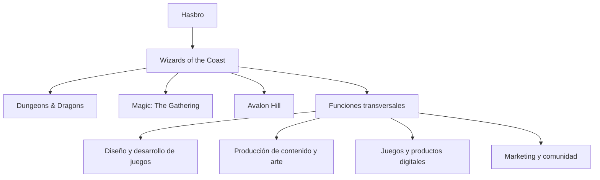
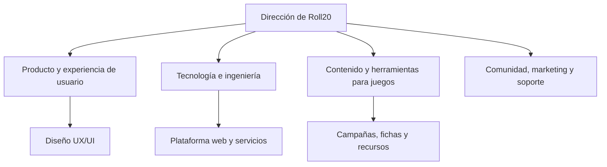
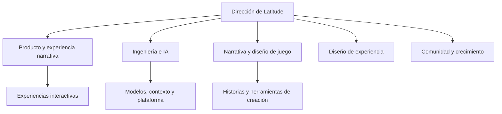
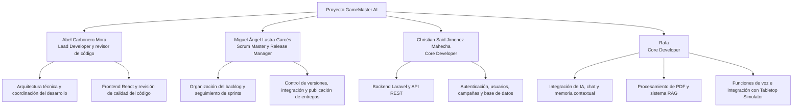

# GameMaster AI — Pitch Inicial & Análisis de Mercado

## 1. Portada y Presentación

- **Nombre de la Startup Ficticia:** GameMaster AI Studios S.L.
- **Producto Digital:** GameMaster AI (Companion App web para la narración por voz mediante IA acotada para juegos de mesa de rol en Tabletop Simulator).
- **Integrantes del Equipo:**
  - **Abel Carbonero Mora**
  - **Miguel Ángel Lastra Garcés**
  - **Christian Said Jimenez Mahecha**
  - **Rafa**
- **Curso Académico:** 2026/2027 — Proyecto Intermodular (2º DAW, ILERNA).

---

## 2. Introducción al Sector

El sector de los juegos de mesa de rol (*Tabletop Role-Playing Games* - TTRPG) y las plataformas virtuales (*Virtual Tabletops* - VTT) vive una transformación histórica impulsada por la digitalización y el auge de las tecnologías generativas.

A escala global, el mercado de las plataformas digitales de juegos de mesa alcanza una valoración de más de 3.800 millones de dólares, mientras que el mercado específico de TTRPG mueve más de 2.300 millones de dólares, con un ritmo de crecimiento (CAGR) superior al 9,6% anual.

Sin embargo, el sector enfrenta una barrera crítica de adopción: la escasez de "Game Masters" o Narradores. Crear y dirigir una campaña requiere decenas de horas de lectura de manuales de cientos de páginas, diseño de mapas y actuación. GameMaster AI nace para eliminar este cuello de botella, actuando como un Narrador virtual por voz acotado a las reglas oficiales que se integra de manera transparente con tableros virtuales como Tabletop Simulator.

## 3. Empresas analizadas y organigramas de referencia

Las empresas se estudian por su relación con el producto: una compañía de referencia en juegos de rol y propiedad intelectual, una plataforma VTT y una empresa de narrativa interactiva con IA. Los organigramas siguientes son **modelos funcionales elaborados para este proyecto**; no son organigramas oficiales ni afirman reproducir puestos internos concretos.

### 3.1. Wizards of the Coast — empresa grande

Wizards of the Coast es una filial de Hasbro y desarrolla juegos de rol, juegos de cartas coleccionables y videojuegos. Entre sus marcas más reconocidas están *Dungeons & Dragons*, *Magic: The Gathering* y Avalon Hill. Su perfil público en LinkedIn indica un tamaño de 501–1.000 empleados; se usa como referencia orientativa, ya que las plantillas y los rangos publicados pueden cambiar.

**Análisis como referencia**

- **Fortalezas:** marcas consolidadas, universos narrativos reconocibles, reglas y contenidos extensos, y comunidades de jugadores que mantienen el interés por sus juegos.
- **Relación con GameMaster AI:** es una referencia para organizar campañas, ambientación y materiales de juego. La plataforma podría permitir que cada grupo cargue sus propios documentos y consulte ese contenido durante la partida.
- **Aprendizaje aplicable:** dar prioridad a la coherencia entre narrativa y reglas, y facilitar que el director de juego encuentre rápidamente información relevante.
- **Diferencia de escala:** GameMaster AI no pretende crear ni sustituir una editorial de juegos; se plantea como herramienta complementaria para dirigir partidas.

**Organigrama funcional de referencia**

### 3.2. Roll20 — empresa mediana

Roll20 es una plataforma web para jugar partidas de rol y otros juegos de mesa en línea. Su producto ofrece herramientas para organizar campañas, gestionar personajes y recursos, y utilizar dados integrados. Su perfil público en LinkedIn indica un tamaño de 51–200 empleados. La clasificación como empresa mediana se mantiene como referencia para el trabajo y no como una afirmación sobre su categoría legal.

**Análisis como referencia**

- **Fortalezas:** acceso desde el navegador, herramientas reunidas en un mismo espacio y funciones pensadas para coordinar una partida a distancia.
- **Relación con GameMaster AI:** es la referencia más directa para la experiencia de uso durante una sesión. GameMaster AI puede complementar un VTT con narración, escucha por voz, contexto y consulta de documentos, en lugar de intentar reemplazar el tablero.
- **Aprendizaje aplicable:** priorizar una interfaz legible mientras se juega, una navegación rápida entre campañas y sesiones, y una integración que no interrumpa el flujo de la partida.
- **Oportunidad de diferenciación:** enfocar el producto en el papel de Dungeon Master asistido por IA y en mantener la respuesta vinculada a las fuentes de la campaña.

**Organigrama funcional de referencia**

### 3.3. Latitude Inc. — empresa pequeña, referencia de narrativa con IA

Latitude se toma como referencia de una empresa de menor escala centrada en experiencias de narrativa interactiva con IA, especialmente por *AI Dungeon*. La web de *AI Dungeon* presenta una experiencia de aventura narrativa generada por IA, en la que las decisiones del jugador influyen en la historia. No se ha encontrado una cifra pública fiable de plantilla para confirmar el tamaño; por ello, «pequeña» se conserva como la clasificación asignada en este proyecto, no como un dato verificado.

**Aclaración sobre AI Game Master:** no se ha podido confirmar que la aplicación *AI Game Master - Dungeon RPG* pertenezca a Latitude. La ficha de la App Store consultada identifica a **Digital Dynasty Entertainment** como desarrollador. Por tanto, en este análisis se trata a Latitude como referencia de narrativa interactiva con IA y a *AI Game Master* como una referencia de producto independiente, salvo que el equipo tenga otra fuente que acredite la relación.

**Análisis como referencia**

- **Fortalezas:** uso de IA para generar historias abiertas, adaptación de la narración a las acciones del jugador y una experiencia centrada en la creatividad y la interacción.
- **Relación con GameMaster AI:** sirve para estudiar cómo hacer que una conversación con IA se sienta dinámica. El proyecto se diferencia al enfocarse en partidas de mesa, documentos de reglas y aventuras aportados por los usuarios, contexto persistente y una posible integración con Tabletop Simulator.
- **Aprendizaje aplicable:** responder a las acciones del jugador manteniendo continuidad narrativa, sin perder de vista límites, fuentes y contexto.
- **Riesgo que se debe controlar:** una historia generativa puede inventar detalles. GameMaster AI debe distinguir entre narración creativa y reglas/documentos verificables, y reconocer cuando no encuentra información suficiente.

**Organigrama funcional de referencia**

### 3.4. Comparativa y aplicación al proyecto

| Referencia | Aportación principal | Qué puede aprender GameMaster AI |
| --- | --- | --- |
| Wizards of the Coast | Juegos, reglas, mundos y marcas de rol | Organizar el contenido de campaña y respetar la coherencia del universo y sus reglas |
| Roll20 | Herramientas web para organizar partidas | Diseñar una interfaz rápida, útil durante la sesión y complementaria al tablero |
| Latitude / *AI Dungeon* | Narrativa interactiva apoyada por IA | Mantener una historia dinámica con contexto, límites y control sobre las respuestas |
| *AI Game Master - Dungeon RPG* | Referencia de producto con narrador de IA | Observar funciones de narración, juego de rol y voz; su ficha consultada atribuye la app a Digital Dynasty Entertainment |

La propuesta de GameMaster AI combina estas referencias sin replicar una sola: toma la organización y consistencia del contenido de juegos de rol, la usabilidad de un VTT y la interacción narrativa de una IA. Su elemento diferenciador será fundamentar las respuestas en los documentos de cada campaña y conectarlas con los eventos de la partida.

### Organigrama de nuestro proyecto

El equipo se organiza por áreas para que cada integrante tenga responsabilidades principales diferenciadas. La distribución es una propuesta de trabajo para GameMaster AI y puede ajustarse según las necesidades de cada sprint.

## 5. Descripción de departamentos y funciones

# Descripción de departamentos y funciones de las empresas

## Índice

1. [Wizards of the Coast](#1-wizards-of-the-coast)
2. [Roll20](#2-roll20)
3. [Latitude Inc.](#3-latitude-inc)
4. [AI Game Master](#4-ai-game-master)
5. [Comparación general](#5-comparación-general)
6. [Conclusión](#6-conclusión)
7. [Fuentes](#7-fuentes)

---

## 1. Wizards of the Coast

### Departamentos y funciones

| Departamento | Funciones principales | Relevancia para la empresa |
|---|---|---|
| Diseño y desarrollo de juegos | Crea reglas, mecánicas, personajes, escenarios y expansiones. Realiza pruebas para equilibrar el juego. | Es el núcleo creativo del negocio y permite desarrollar productos atractivos. |
| Arte y diseño gráfico | Diseña ilustraciones, personajes, cartas, manuales, cajas y otros elementos visuales. | Da identidad visual a los juegos y aumenta su atractivo. |
| Producción y publicación | Coordina la fabricación de cartas, libros y otros productos, así como su preparación para el lanzamiento. | Garantiza que los productos estén disponibles con la calidad prevista. |
| Marketing y comunicación | Organiza campañas publicitarias, promociona novedades y comunica lanzamientos. | Genera interés, impulsa las ventas y fortalece las marcas. |
| Ventas y distribución | Gestiona la comercialización mediante tiendas, distribuidores y otros canales. | Permite que los productos lleguen a los consumidores y genera ingresos. |
| Comunidad y eventos | Organiza actividades, torneos y programas de juego, y colabora con comunidades de jugadores. | Fideliza a los clientes y mantiene activa la comunidad. |
| Tecnología y desarrollo digital | Mantiene plataformas digitales, herramientas en línea y productos tecnológicos relacionados con los juegos. | Amplía las formas de jugar y permite llegar a nuevos públicos. |
| Finanzas y administración | Controla presupuestos, ingresos, costes e inversiones. | Ayuda a mantener la rentabilidad y planificar futuros lanzamientos. |
| Recursos humanos | Gestiona la contratación, formación y desarrollo profesional de los trabajadores. | Permite contar con los profesionales necesarios. |
| Legal y propiedad intelectual | Gestiona licencias, marcas registradas, derechos de autor y contratos. | Protege las creaciones y sus derechos comerciales. |

**Contribución al negocio:** los departamentos creativos desarrollan los juegos; producción y distribución los llevan al mercado; y marketing, ventas y comunidad mantienen el interés de los consumidores.

---

## 2. Roll20

### Departamentos y funciones

| Departamento | Funciones principales | Relevancia para la empresa |
|---|---|---|
| Desarrollo de software | Programa y mantiene la plataforma, implementa nuevas funciones y corrige errores. | Garantiza el funcionamiento del servicio. |
| Diseño UX/UI | Diseña la interfaz y organiza las herramientas para que sean intuitivas. | Mejora la experiencia de jugadores y directores de juego. |
| Infraestructura y operaciones técnicas | Supervisa los servidores, el rendimiento, la disponibilidad y la escalabilidad. | Permite que las partidas en línea funcionen de forma estable. |
| Gestión de producto | Define prioridades, analiza las necesidades de los usuarios y planifica mejoras. | Ayuda a desarrollar funciones útiles y competitivas. |
| Contenidos y catálogo | Organiza mapas, fichas, recursos digitales y materiales oficiales o de colaboradores. | Aumenta las posibilidades de juego. |
| Marketing y comunicación | Promociona la plataforma, comunica novedades y atrae nuevos usuarios. | Incrementa la visibilidad y favorece el crecimiento. |
| Ventas y alianzas comerciales | Gestiona acuerdos con editoriales, licencias y contenidos de pago. | Amplía el catálogo y genera ingresos. |
| Atención al cliente | Resuelve dudas y problemas técnicos relacionados con cuentas, suscripciones y funciones. | Mejora la satisfacción y fidelización. |
| Comunidad y moderación | Gestiona espacios comunitarios y fomenta un entorno adecuado. | Mantiene una comunidad activa. |
| Administración, finanzas y recursos humanos | Controla ingresos, gastos, suscripciones y organización del personal. | Favorece la sostenibilidad económica. |
| Seguridad y protección de datos | Protege las cuentas, los datos de usuarios y los sistemas de la plataforma. | Reduce riesgos y refuerza la confianza. |

**Contribución al negocio:** el desarrollo y las operaciones técnicas mantienen la plataforma disponible, mientras que producto, contenidos, marketing y atención al cliente mejoran la experiencia y favorecen la fidelización.

---

## 3. Latitude Inc.

### Departamentos y funciones

| Departamento | Funciones principales | Relevancia para la empresa |
|---|---|---|
| Diseño de juegos y narrativa | Define mundos, personajes, misiones, reglas y experiencias narrativas. | Hace que los juegos sean interesantes y ofrezcan libertad de elección. |
| Investigación y desarrollo de IA | Investiga y mejora los sistemas de inteligencia artificial que generan historias y respuestas. | Diferencia sus productos de los juegos tradicionales. |
| Ingeniería de software | Desarrolla aplicaciones, interfaces, sistemas de cuentas y herramientas para los jugadores. | Convierte la tecnología en un producto funcional. |
| Infraestructura y sistemas | Gestiona servicios en la nube, capacidad de procesamiento, rendimiento y costes técnicos. | Mantiene la estabilidad y controla los costes de la IA. |
| Diseño de producto y experiencia de usuario | Analiza cómo juegan los usuarios y mejora las funciones y la facilidad de uso. | Favorece la satisfacción y la continuidad de uso. |
| Arte y generación multimedia | Desarrolla o integra imágenes y otros recursos visuales generados mediante IA. | Enriquece la experiencia y hace los mundos más inmersivos. |
| Control de calidad y evaluación de IA | Prueba los juegos, detecta errores y evalúa la coherencia de las historias. | Mejora la calidad y reduce fallos. |
| Comunidad y atención al usuario | Recoge opiniones, responde a incidencias y mantiene la comunicación con los jugadores. | Permite conocer las necesidades de los usuarios. |
| Marketing y crecimiento | Promociona los juegos, desarrolla campañas y busca nuevos públicos. | Aumenta la visibilidad y el número de jugadores. |
| Finanzas y monetización | Gestiona presupuestos, suscripciones, compras y costes de infraestructura. | Ayuda a mantener la rentabilidad. |
| Legal, privacidad y seguridad | Gestiona condiciones de uso, propiedad intelectual, protección de datos y riesgos relacionados con la IA. | Favorece el cumplimiento legal y un uso responsable. |

**Contribución al negocio:** la investigación de IA, la ingeniería y el diseño narrativo crean experiencias interactivas. La infraestructura y las finanzas permiten mantenerlas a un coste sostenible.

---

## 4. AI Game Master

### Departamentos y funciones

| Departamento | Funciones principales | Relevancia para la empresa |
|---|---|---|
| Diseño de videojuegos y narrativa | Diseña aventuras, personajes, mundos, misiones, combates y reglas. | Define la identidad del juego y la calidad de las aventuras. |
| Desarrollo de inteligencia artificial | Integra modelos de IA para generar narraciones, diálogos y acontecimientos adaptados a las decisiones del jugador. | Es el núcleo tecnológico de las historias dinámicas. |
| Desarrollo de aplicaciones | Programa y mantiene la aplicación móvil, sus funciones y la conexión con los servicios de IA. | Permite acceder al juego y utilizar sus funciones. |
| Arte y contenido multimedia | Crea o integra imágenes, escenarios y recursos visuales generados mediante IA. | Mejora la presentación visual y la inmersión. |
| Control de calidad y pruebas | Comprueba el funcionamiento, detecta errores y evalúa la calidad de las respuestas de la IA. | Evita problemas técnicos y mejora la experiencia. |
| Diseño UX/UI | Organiza los menús, las pantallas, la creación de personajes y las opciones de interacción. | Facilita el uso de la aplicación. |
| Marketing y comunicación | Promociona el juego en tiendas de aplicaciones, redes sociales y comunidades. | Ayuda a conseguir nuevos jugadores. |
| Comunidad y soporte técnico | Responde a consultas, recoge sugerencias y comunica problemas al equipo de desarrollo. | Permite identificar necesidades y mejorar el producto. |
| Gestión económica y monetización | Administra compras integradas, posibles planes de pago, presupuestos y costes de IA. | Ayuda a financiar el desarrollo y mantener el juego. |
| Administración, legal y privacidad | Gestiona condiciones de uso, pagos, propiedad intelectual y protección de datos. | Favorece el cumplimiento legal y la confianza de los usuarios. |

**Contribución al negocio:** el diseño narrativo y la IA generan las aventuras, mientras que el desarrollo y las pruebas garantizan el funcionamiento. Marketing, soporte y monetización ayudan a mantener y ampliar el producto.

---

## 5. Comparación general

| Empresa | Actividad principal | Departamentos más estratégicos |
|---|---|---|
| Wizards of the Coast | Creación y comercialización de juegos de cartas, rol y productos digitales. | Diseño de juegos, arte, producción, marketing y distribución. |
| Roll20 | Plataforma en línea para jugar partidas de rol y juegos de mesa. | Desarrollo de software, infraestructura, diseño UX/UI y gestión de producto. |
| Latitude Inc. | Desarrollo de experiencias narrativas interactivas mediante IA. | Investigación de IA, ingeniería, diseño narrativo e infraestructura. |
| AI Game Master | Videojuego de rol con aventuras generadas mediante IA. | Desarrollo de aplicaciones, inteligencia artificial, narrativa y control de calidad. |

---

## 6. Conclusión

Aunque las cuatro empresas están relacionadas con los juegos y el entretenimiento, cada una necesita priorizar departamentos diferentes según su actividad.

- **Wizards of the Coast** depende especialmente de la creatividad, el diseño de juegos, la producción y la distribución.
- **Roll20** necesita una plataforma tecnológica estable, fácil de utilizar y capaz de conectar a jugadores de diferentes lugares.
- **Latitude Inc.** destaca por la investigación en inteligencia artificial y el desarrollo de sistemas narrativos interactivos.
- **AI Game Master** combina programación, inteligencia artificial y diseño narrativo para ofrecer aventuras personalizadas.

En conclusión, todos los departamentos contribuyen al funcionamiento de una empresa. Los departamentos de desarrollo de producto y tecnología son especialmente importantes en las plataformas digitales y los videojuegos basados en IA, mientras que marketing, finanzas, soporte y administración permiten transformar los productos en negocios sostenibles.

---

## 7. Fuentes

- **Wizards of the Coast:** [Web corporativa](https://company.wizards.com/es/who-we-are)
- **Roll20:** [Web oficial](https://roll20.net/) | [Centro de ayuda](https://help.roll20.net/)
- **Latitude Inc.:** [Información corporativa](https://latitude.io/press)
- **AI Game Master:** [Web oficial](https://www.aigamemaster.app/about)

> **Nota metodológica:** las fuentes describen las actividades y los productos de las empresas. La clasificación de departamentos es un análisis funcional elaborado para este trabajo y no implica que cada empresa publique un organigrama con todas estas áreas. Algunas funciones pueden estar agrupadas en un mismo equipo o externalizadas.

## 6. Necesidades y volumen de negocio.
